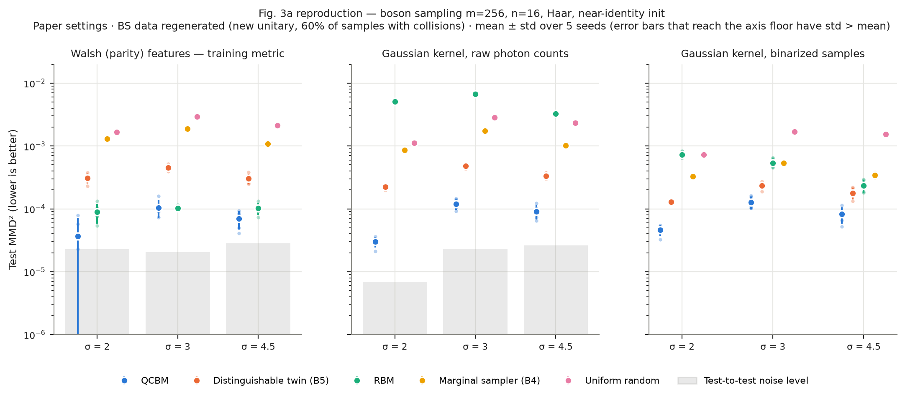
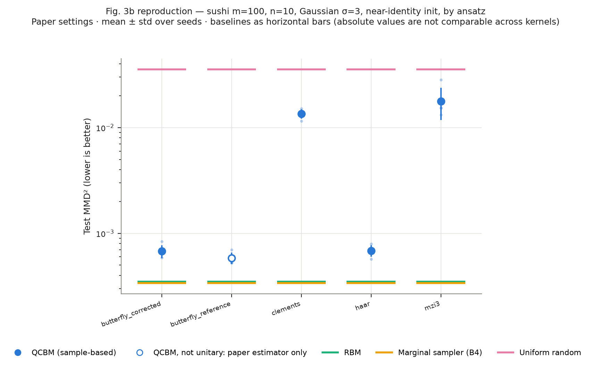
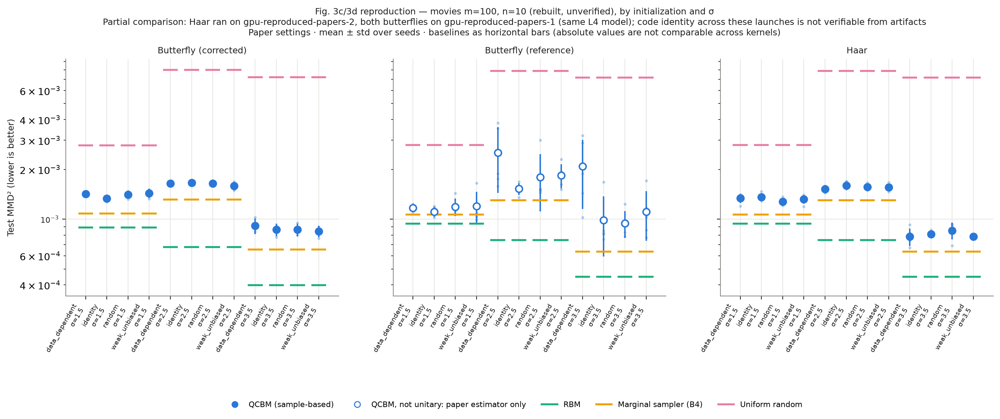
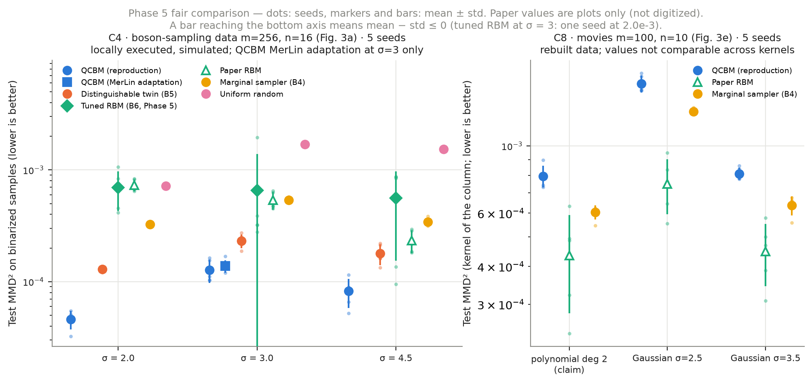
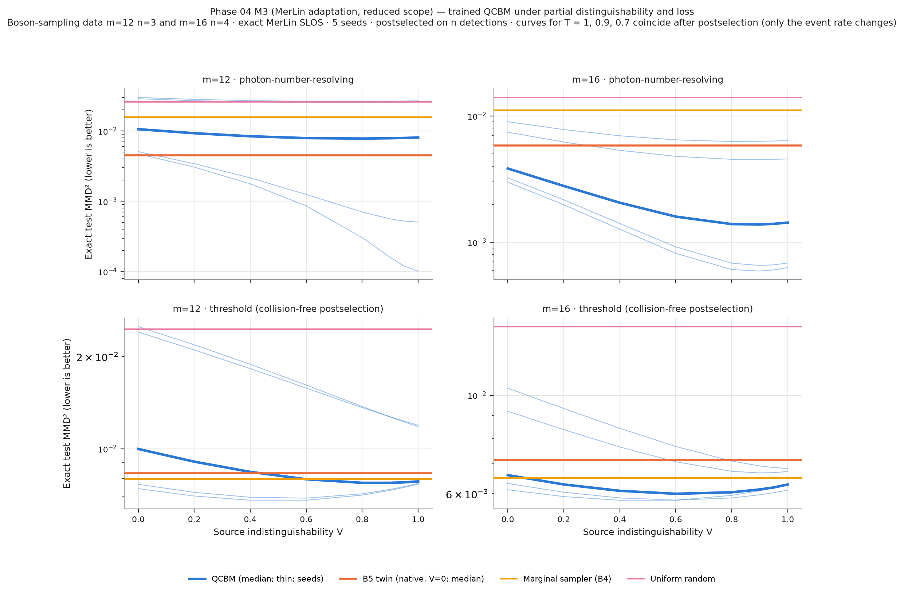
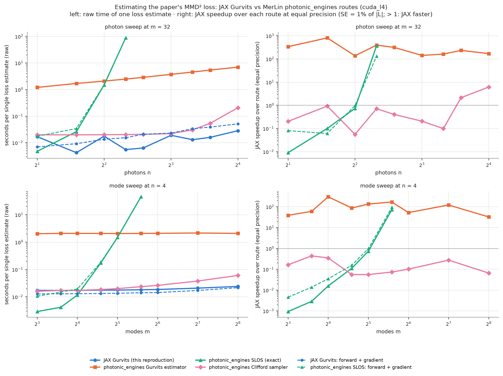
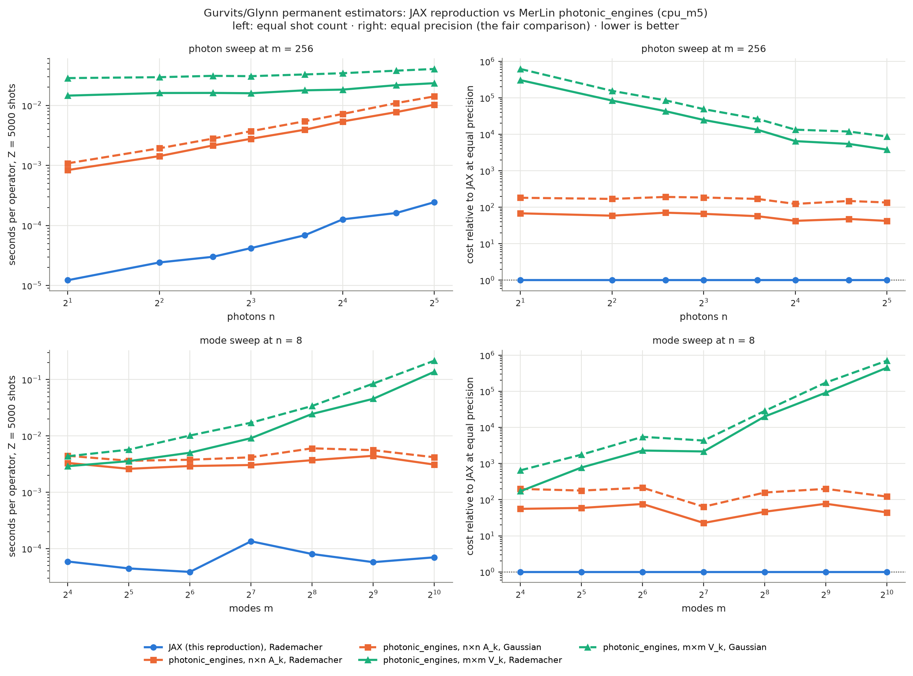

# Efficient Training of Photonic Quantum Generative Models - Reproduction

> Status: paper experiments run (Phase 03, 5 seeds, NVIDIA L4); MerLin adaptation
> run (Phase 04, `MERLIN_IMPLEMENTATION`); fair comparison run (Phase 05); walkthrough in [`notebook.ipynb`](notebook.ipynb) (Phase 07). Working log: [`LOG.md`](LOG.md);
> durable lessons: [`INSIGHTS.md`](INSIGHTS.md).

## Reference and Attribution

- Paper: *Efficient training of photonic quantum generative models* (arXiv preprint, v1 2026-03-09, v2 2026-07-03)
- Authors: Felix Gottlieb, Chayma Faraji, Rawad Mezher, Brian Ventura, Shane Mansfield, Alexia Salavrakos
- arXiv: [2603.08793](https://arxiv.org/abs/2603.08793)
- Original repository: https://github.com/merlinquantum/generative_classical_training (JAX).
- License and attribution: the paper belongs to its authors. The original code is MIT-licensed (Copyright (c) 2026 merlinquantum); code adapted from it must keep that notice. Cite the original paper (see below).

## Original Paper

The paper transfers "train on classical, deploy on quantum" from IQP circuits
to linear optics. A photonic quantum circuit Born machine (QCBM) sends n single
photons through a parametrized m-mode interferometer U and outputs the detected
occupation pattern. For fixed-Hamming-weight, collision-free data the
Gaussian-kernel MMD equals an average over Walsh operators W_k of squared
differences of expectation values (Prop. 1); each model expectation is a single
permanent of an n x n matrix, estimated classically with Gurvits' algorithm
(Fig. 1). Training therefore runs on a laptop with autodiff and Adam, while
sampling the trained model is boson sampling.

Main claims: training is efficient up to m = 256, n = 16 and more than 100 000
parameters; on boson-sampling data the QCBM beats an RBM and a uniform random
model (Fig. 3a); butterfly and Haar-compatible ansätze beat Clements and 3-MZI
(Fig. 3b); initialization matters little except a block-structure
initialization on toy block data (Fig. 3c-d, Fig. 4); the polynomial kernel
often beats the Gaussian (Fig. 3e-f). Results are given as plots only. The
claim and experiment inventories are in `LOG.md`.

## Reproduction Scope, Claims, and Deviations

Reproduced (planned in `LOG.md`): every figure of the paper (Fig. 2a-b, 3a-f,
4a-b) on the paper's datasets, with 5 seeds where compute allows, plus exact
small-size checks of the estimator (Prop. 1-2, App. A) and of App. B.


Claims tested (IDs from `LOG.md`, "Claim Inventory"); verdicts are in the results table below:
C1 estimator identity, C2 efficient training, C3 sample-size oscillations, C4 QCBM beats the
classical models on boson-sampling data, C5 ansatz ranking, C6 initialization gaps, C7 block
initialization, C8 kernel choice (incl. "QCBM overtakes the RBM" on movies), C9 App. B.
C10 (bandwidth warm start) was not run; C11 (dequantization) is not testable.

Updates and deviations:

- Implementation adapted from the authors' JAX code (MIT) rather than
  re-derived; checked against exact permanents and the MerLin fork's SLOS
  simulation (`tests/test_estimator.py`).
- Optimizer: `optax.adam` directly instead of the deprecated
  `jaxopt.OptaxSolver` wrapper (same update rule, same per-step resampling,
  same stopping rule).
- The estimator builds U_S^dagger W_k U_S from the n input columns (O(m n^2))
  instead of the full m x m product (O(m^3)); identical values, about 8x
  faster at m = 100 (1.1 s/step vs 8.5 s/step on an Apple M5).
- complex128 circuits (original: complex64).
- Butterfly mesh: the original code is not unitary for m = 100 (84 of 4950
  MZIs address modes >= 100; singular values from 0 to 3.6 at random
  initialization). Both the original (`--butterfly-variant reference`) and a
  corrected variant (`corrected`) are available.
- Boson-sampling data: regenerated with the paper's recipe and fixed seeds
  (the authors' unitary was not released). 60.4% of its samples contain a
  collision, so the paper's no-collision assumption does not hold there; all
  models are scored with the same sample-based estimators on raw and binarized
  samples.
- Movie and bioinformatics datasets: rebuilt from the raw data with the
  authors' scripts at m = 100, n = 10 (two undefined names fixed in the movie
  script). Unverified against the authors' files.
- Added fair baselines: B4 independent-marginal fixed-weight sampler and B5
  distinguishable-photon twin (same circuit, classically samplable).
- Hardware: paper runs on two NVIDIA L4 machines (`gpu-reproduced-papers-1/2`, JAX CUDA); local
  checks on an Apple M5 CPU. The paper used "a laptop" (CPU).
- Added in Phase 05: a tuned RBM (B6) trained on binarized data, the fair classical baseline for
  the boson-sampling claim.

## Project Layout

```text
papers/photonic_MMD_generative/
|-- cli.json, configs/            # paper, MerLin (*_merlin) and baseline (*_classical) configs; configs/sweeps/
|-- lib/
|   |-- runner.py                 # train_and_evaluate: QCBM / B5 (jax or merlin backend) or B6 (rbm_tuned)
|   |-- estimator.py, exact.py    # Gurvits/Walsh MMD estimator (Fig. 1, Eq. 15); exact permanents and MMD
|   |-- circuits.py, kernels.py   # ansätze (haar, clements, butterfly, mzi3); App. A kernels as P(k)
|   |-- initialization.py, training.py, data.py
|   |-- baselines.py              # paper RBM, random, B4, B5 samplers, Perceval boson sampler
|   |-- qcbm_merlin.py            # Phase 04 MerLin backend, sampler, noise study
|   `-- rbm_classical.py          # Phase 05 tuned RBM (B6)
|-- utils/                        # sweeps, summaries, plots, comparison tables
|-- tests/                        # pytest suite
|-- results/                      # curated figures and generated tables
|-- notebook.ipynb, models/, outdir/ (raw runs, git-ignored)
```

## Install and How to Run

```bash
python -m venv .venvs/reproduction
source .venvs/reproduction/bin/activate
pip install -e <benchmarking-repo>/merlin      # MerLin fork (photonic_engines) first
pip install -r papers/photonic_MMD_generative/requirements.txt
pip install "git+https://github.com/XanaduAI/iqpopt@bf207502c317364746bd56ae0dd1b4d04e492c7b"
pip install "git+https://github.com/XanaduAI/qml-benchmarks@95e5a07e8e9e75ba7e24e67fb32b030112a1309a"
```

Quick checks (seconds):

```bash
# From the repository root
python implementation.py --paper photonic_MMD_generative --help
python implementation.py --paper photonic_MMD_generative --config configs/defaults.json
python implementation.py --paper photonic_MMD_generative --config configs/smoke.json
python implementation.py --paper photonic_MMD_generative --config configs/runtime_probe.json

# From inside papers/photonic_MMD_generative
python ../../implementation.py --config configs/smoke.json
```

Build the prepared datasets once (writes `data/photonic_MMD_generative/prepared/`):

```bash
python papers/photonic_MMD_generative/utils/prepare_datasets.py --configs \
    fig3a_bs_original fig3b_sushi_original fig3c_movies_original \
    fig3f_bio_low_order fig4a_pairwise_sushi_original fig4b_mushroom_original
```

Paper experiments (one run per command; sweep the flags shown in each
config's description):

```bash
python implementation.py --paper photonic_MMD_generative --config configs/fig3a_bs_original.json --sigma 3.0 --seed 0
python implementation.py --paper photonic_MMD_generative --config configs/fig3a_bs_classical.json --sigma 3.0 --seed 0
python implementation.py --paper photonic_MMD_generative --config configs/fig3b_sushi_original.json --ansatz butterfly --butterfly-variant corrected --seed 0
```

Full sweeps, as run here (one coordinator per sweep, from the repository root; add
`--device cuda:0` on a GPU machine):

```bash
python papers/photonic_MMD_generative/utils/run_sweep.py configs/sweeps/fig3a_bs.json --data-root ../../data/photonic_MMD_generative
python papers/photonic_MMD_generative/utils/summarize_sweep.py papers/photonic_MMD_generative/outdir/sweep_fig3a_bs_<stamp>
python papers/photonic_MMD_generative/utils/make_results_tables.py <sweep dirs>
```

Each run writes `outdir/run_YYYYMMDD-HHMMSS/` with `run.log`,
`run_status.json`, `config_snapshot.json`, `metrics.json`, `losses.csv`,
`params.npy`, `unitary.npy` and `samples.npz`.

## Configuration

`cli.json` is the authoritative schema of the paper flags: `--steps`,
`--sigma`, `--ansatz`, `--butterfly-variant`, `--photon-model`, `--init`,
`--perturbation`, `--n-operators`, `--n-gurvits`, `--sample-metrics`, `--backend`, `--sampler`. The
shared runtime adds `--config`, `--outdir`, `--seed`, `--dtype`, `--device`,
`--log-level`, `--data-root`.

| Config | Purpose |
|---|---|
| `defaults.json` | Runnable synthetic default (m = 8, n = 2, 20 steps); not a paper setting |
| `smoke.json` | Defaults plus a short RBM fit, every code path once |
| `runtime_probe.json` | E11: seconds per step at m = 100, n = 10 |
| `fig2a_bs_original.json`, `fig2b_bs_original.json` | Fig. 2: loss curves, \|K\| = \|Z\| = 2000 / 5000 |
| `fig3a_bs_original.json`, `fig3a_bs_classical.json` | Fig. 3a and baseline B5 |
| `fig3b_sushi_original.json` | Fig. 3b ansatz comparison |
| `fig3c_movies_original.json`, `fig3c_movies_reduced.json` | Fig. 3c (paper and reduced settings) |
| `fig3d_movies_original.json`, `fig3d_movies_reduced.json` | Fig. 3d |
| `fig3e_movies_gaussian.json`, `fig3e_movies_polynomial.json` | Fig. 3e |
| `fig3f_bio_<kernel>.json` | Fig. 3f, one per kernel (`weighted_gaussian_paper` = paper's weight normalization) |
| `fig4a_pairwise_sushi_original.json`, `fig4a_pairwise_sushi_reduced.json` | Fig. 4a |
| `fig4b_mushroom_original.json` | Fig. 4b |
| `fig3a_bs_merlin.json`, `fig3a_bs_merlin_classical.json`, `fig3b_sushi_merlin.json` | Phase 04 MerLin adaptation (M1/M2) |
| `noise_study_bs_m12_merlin.json`, `noise_study_bs_m16_merlin.json` | Phase 04 noise and detector study (M3) |
| `fig3a_bs_rbm_tuned_classical.json`, `smoke_rbm_tuned_classical.json` | Phase 05 tuned RBM baseline B6 (`model.backend = "rbm_tuned"`, `tuning` section) |
| `configs/sweeps/*.json` | One spec per sweep: candidates, seeds, metric, direction, tie rule |

Settings the paper does not state (|K|, |Z|, steps, learning rate, input state,
perturbation size) come from the authors' code; each config's `description`
says which.

## Data

Datasets live under `data/photonic_MMD_generative/` at the repository root
(git-ignored; several licenses forbid redistribution). Exact sources,
revisions, checksums and the re-download commands are in `LOG.md`
(Data Acquisition Log).

| Dataset | Path | Source | Status |
|---|---|---|---|
| Boson sampling m=256, n=16 | `prepared/boson_sampling_m256_n16_dc2ef771c2/` | Perceval `Clifford2017Backend`, paper recipe | Generated in Phase 02 (unitary seed 2603, sample seed 8793); 60.4% of samples have a collision; the authors' unitary was not released |
| Sushi top-10 of 100 | `preflib_sushi/00014-00000002.soi` | PrefLib-Data @ `220b7e5c` | Original, verified |
| Sushi ranking of 10 (pairwise toy) | `kamishima_sushi3/extracted/sushi3-2016/sushi3a.5000.10.order` | https://www.kamishima.net/asset/sushi3-2016.zip | Original, verified |
| UCI Mushroom | `uci_mushroom/raw/data.csv` | https://archive.ics.uci.edu/static/public/73/data.csv (DOI 10.24432/C5959T) | Original, verified |
| Netflix movie ratings | `netflix_movie_ratings/raw/archive/Netflix_User_Ratings.csv` (+ `movies.csv`, `../archive.zip`) | Kaggle `evanschreiner/netflix-movie-ratings` (placed by the user) | Original Kaggle package, verified (100 480 507 ratings, 480 189 users, 17 770 movies); license on Kaggle "Unknown" (Netflix Prize data) |
| CMap / LINCS 2020 | `cmap_lincs2020/level5_beta_trt_xpr_n142901x12328.gctx` (+ `geneinfo_beta.txt`) | CLUE LINCS2020 build, https://s3.amazonaws.com/macchiato.clue.io/builds/LINCS2020/ (placed by the user) | Original raw files, verified byte-identical to the S3 build (ETags); 142 901 signatures × 12 328 genes, 978 landmarks; CLUE Terms of Use |

Sushi data: research use only, no redistribution (T. Kamishima). Mushroom:
CC BY 4.0. Netflix: Kaggle repackaging of the Netflix Prize data, license
listed as "Unknown"; kept local only. The prepared movie dataset was
rebuilt with the authors' script (two undefined names fixed; m = 100, n = 10,
253 267 users, 10 000 / 10 000 split) and is labelled "rebuilt with the authors'
scripts, unverified" (no reference hashes published). The same label applies to
the bioinformatics dataset built from the CMap GCTX (seed-42 subset of 10 000
signatures on the 978 landmark genes). CMap data: CLUE Terms of Use; kept local
only.

Prepared datasets (train/test arrays, manifest with SHA-256) are built once with
`utils/prepare_datasets.py` into `data/photonic_MMD_generative/prepared/`. Remote
GPU runs use a copy holding only the prepared data,
`data/photonic_MMD_generative_prepared/` (passed as `--data-root`), which also
carries the MerLin fork wheel for Linux machines (`wheels/`). No synthetic
fallback was needed; `defaults.json` uses a synthetic uniform fixed-weight
dataset only as a pipeline check.

## Results Obtained and Comparison with the Paper

All experiments ran at the paper's settings (taken from the authors' code where
the paper is silent) on NVIDIA L4 GPUs, 5 seeds unless stated. Metric: MMD² between
model samples and the test split (lower is better), mean over seeds; the paper's own
Gurvits-estimator value is in `results/results_tables.md`. The paper reports plots
only and its figures were not digitized, so **paper values are qualitative and no
numeric delta can be computed** (# TODO: digitize Figs. 2–4). Metric agreement is
therefore "not assessable"; trend agreement compares rankings and directions.
Claim-by-claim reasoning: `LOG.md`, "Phase 03 Results" and "Phase 5 Results".

| Paper item | Claim tested | Paper value | Reproduced value | Delta | Metric agreement | Trend agreement | Claim support | Seeds | Comment |
|---|---|---|---|---:|---|---|---|---:|---|
| Prop. 1–2, App. A | C1 | exact identity (theory) | estimator = brute-force MMD to 1e-10; unbiased (z = 0.38); MerLin SLOS oracle to 1e-12 | N/A | yes (exact) | yes | supported | — | `tests/test_estimator.py`, synthetic small m, n |
| §6 text (E11) | C2 | 3–4 s/step at m=100, n=10 on "a laptop" | 0.88 s/step (M5 CPU), 0.14 s/step (L4); m=256, n=16: 0.21 s/step (L4) | N/A (different hardware) | not comparable | yes | supported | 1 | column-only estimator; original-code pattern 8.7 s/step on the M5 |
| Fig. 2a/2b | C3 | plot: smooth decrease, fewer oscillations at \|K\|=\|Z\|=5000 | step-to-step std 7.5e-6 (2000) vs 3.7e-6 (5000) | N/A | not assessable | yes | supported (preliminary) | 1 | regenerated BS data; label: preliminary |
| Fig. 3a | C4 | plot: QCBM clearly below RBM and random | raw counts: QCBM 3.0e-5 / 1.2e-4 / 9.1e-5 vs RBM 5.1e-3 / 6.6e-3 / 3.3e-3 (σ 2 / 3 / 4.5); binarized: QCBM 4.6e-5 / 1.3e-4 / 8.2e-5 vs tuned RBM 7.0e-4 / 6.5e-4 / 5.6e-4 | N/A | not assessable | yes on the paper's metric | partially supported | 5 | margin depends on metric; tied with RBMs on parity features at σ 3; classically samplable twin B5 within 1.8–2.8× (see Fair Baselines) |
| Fig. 3b | C5 | plot: butterfly, Haar below Clements, 3-MZI | Haar 6.9e-4, butterfly (corrected) 6.8e-4, Clements 1.35e-2, 3-MZI 1.78e-2 | N/A | not assessable | yes | supported | 5 | original-code butterfly is not unitary at m=100 (not deployable) |
| Fig. 3c/3d | C6 | plot: no large gaps; butterfly more sensitive | Haar, corrected butterfly: all inits within ≈1 std; original butterfly 1.8e-3 ± 6.8e-4 (random, σ 2.5) with matrices 1.0–3.7 from unitary | N/A | not assessable | partial | partially supported | 5 (3 corrected) | rebuilt movie data; Haar vs butterfly is cross-machine (partial); sensitivity is an artifact of the butterfly bug |
| Fig. 3e | C8 (RBM) | plot: polynomial QCBM slightly below RBM | polynomial: QCBM 7.9e-4 vs RBM 4.4e-4; RBM ahead under every kernel | N/A | not assessable | no | unsupported | 5 | reproduces only when the QCBM's polynomial score is compared with the RBM's Gaussian σ 2.5 score (7.15e-4 vs 7.7e-4) |
| Fig. 3f | C8 (kernels) | plot: polynomial often better; QCBM vs random | QCBM below random under all six kernels; parity polynomial and paper-normalized weighted Gaussian score every model at noise level | N/A | not assessable | yes vs random | supported vs random | 5 | rebuilt bio data; code study settings \|K\|=1500, \|Z\|=1000 |
| Fig. 4a/4b | C7 | plot: block-structured init best | pairwise sushi 9.8e-3 vs 1.6e-2–3.5e-2; mushroom 9.7e-3 vs 1.2e-2–1.6e-2 | N/A | not assessable | yes | supported | 5 | smaller margin on mushroom |
| App. B | C9 | B.1–B.3 (theory) | B.2 marginal formula exact (1e-12); B.1 near-identity bound checked; B.3 not tested | N/A | yes | yes | supported (B.1, B.2) | — | `tests/test_appendix_b.py` |
| — (MerLin, Phase 04) | C4, C5 under MerLin | — | Fig. 3a σ 3 and Fig. 3b: training identical to JAX to 1e-16; sample metrics within 2 SE | N/A | — | same ranking | adaptation, not reproduction | 5 | hardware fields in "Hardware-Aware Settings" |

### Sweep index

Every sweep is a comparison sweep: metric minimized on the test split, final
parameters, mean and std (ddof=1) over seeds, no candidate selected (differences
within one pooled std reported as "not separated"; Phase 05 uses 2 SE). Full
candidate tables, generated from `metrics.json` by `utils/summarize_sweep.py` and
`utils/make_results_tables.py` (Phase 03), `utils/compare_backends.py` and
`utils/analyze_noise_study.py` (Phase 04), `utils/make_comparison_table.py` (Phase 05):

| Sweep | Runs (completed / expected) | Coverage | Full table |
|---|---:|---|---|
| fig2_bs | 2 / 2 | COMPLETE | [`results/results_tables.md`](results/results_tables.md) |
| fig3a_bs | 30 / 30 | COMPLETE | same |
| fig3b_sushi | 20 / 25 | PARTIAL: the 5 original-butterfly runs failed at sampling (non-unitary) | same |
| fig3b_sushi_butterfly_reference_attempt2 | 5 / 5 | COMPLETE (trained, not deployable) | same |
| fig3c_movies_haar | 60 / 60 | COMPLETE | same |
| fig3d_movies_butterfly_reference (first launch) | 3 failed, 1 stopped / 60 | STOPPED, superseded | `LOG.md`, Sweep Execution Ledger |
| fig3d_movies_butterfly_reference (relaunch) | 60 / 60 | COMPLETE (trained, not deployable) | [`results/results_tables.md`](results/results_tables.md) |
| fig3d_movies_butterfly_corrected | 36 / 36 | COMPLETE (3 seeds by plan) | same |
| fig3e_movies | 15 / 15 | COMPLETE | same |
| fig3f_bio | 30 / 30 | COMPLETE | same |
| fig4a_pairwise_sushi, fig4b_mushroom | 25 / 25 each | COMPLETE | same |
| fig3c_movies_haar_determinism_check | 2 / 2 | COMPLETE (cross-machine check) | `LOG.md`, Sweep Records |
| fig3a_bs_merlin, fig3b_sushi_merlin | 10 / 10 each | COMPLETE | [`results/phase4_fig3a_backend_comparison.json`](results/phase4_fig3a_backend_comparison.json), [`phase4_fig3b`](results/phase4_fig3b_backend_comparison.json) |
| noise_study_merlin | 20 / 20 | COMPLETE | [`results/phase4_noise_study.md`](results/phase4_noise_study.md) |
| fig3a_bs_rbm_tuned (B6) | 5 / 5 | COMPLETE | [`results/phase5_comparison.md`](results/phase5_comparison.md) |

Findings beyond the paper:

- **Butterfly mesh (original code) is not a valid circuit for m = 100.** 84 of
  its 4950 MZIs address modes ≥ 100; the trained matrices drift 1–4 units from
  unitary. Perceval refuses to sample them. A corrected mesh behaves like Haar.
- **No-collision assumption.** The boson-sampling data has collisions in 60% of
  samples (m = n² = 256), and the QCBM trained on movies puts 9–11% of its
  samples on collision outcomes the data never contains (m = n² = 100).
- **Simple baselines.** An independent-marginal fixed-weight sampler beats the
  best QCBM on sushi, movies and bioinformatics; on movies the QCBM matches the
  marginals but captures no pairwise co-occurrence structure. The QCBM wins on
  boson-sampling data and on the block toy datasets.
- **Speed.** Building the estimator from the n input columns and compiling the
  whole step gives 0.88 s/step on an Apple M5 CPU and 0.14 s/step on an L4 at
  m = 100 (8.7 s/step for the original code's operation pattern on the M5).





Other figures: [`fig2_bs_loss_curves`](results/fig2_bs_loss_curves.png),
[`fig3e_comparison`](results/fig3e_comparison.png),
[`fig3f_comparison`](results/fig3f_comparison.png),
[`fig4_init_curves`](results/fig4_init_curves.png).

## Fair Baselines

Phase 05 (`LOG.md`, "Phase 5 Comparison Plan" and "Phase 5 Results").

The paper makes two claims against a classical model: the QCBM beats the RBM
and the random model on boson-sampling data (C4, Fig. 3a), and on movies, with
the polynomial kernel, it "slightly overtakes" the RBM (C8, Fig. 3e). The axis
is generative quality, measured as test MMD². The protocol was fixed before the
new runs (`LOG.md`, "Phase 5 Comparison Plan"):

- every model is scored with the same estimator on the same 5000-sample test
  split, with 2000 samples per model and seeds 0–4;
- two results count as different only when they differ by more than 2 standard
  errors.

**Baseline fairness.** For C4 the paper's RBM is not a fair comparator. Its
units are binary, but 60% of boson-sampling samples have a mode with two or
more photons. It was also trained on raw counts, untuned, sampled after only 10
Gibbs steps, and has 8× fewer parameters than the QCBM. This phase adds a tuned
RBM (B6, `lib/rbm_classical.py`):

- trained on binarized data;
- 18 candidates (6 trained models × 3 chain lengths): hidden units 64, 256 or 512 (512 matches the QCBM's
  131,072 parameters), learning rate 1e-2 or 1e-3, and 10, 100 or 1000 Gibbs
  steps;
- the best setting chosen on a validation split taken from the training set,
  then refit on the full training set.

The main metric is the Gaussian MMD² on binarized samples, because it is the
representation every model can produce. For C8 the paper's RBM is adequate:
movie data are binary, and every remaining handicap counts against the RBM.

| Claim | Main metric, QCBM vs the strongest classical baseline | Outcome |
|---|---|---|
| C4, σ = 2 / 3 / 4.5 | QCBM 4.6e-5 / 1.3e-4 / 8.2e-5. Tuned RBM 7.0e-4 / 6.5e-4 / 5.6e-4: QCBM better at σ 2 and 4.5, not separated at σ 3 (std 7.3e-4, one seed at 2.0e-3). Distinguishable twin B5 1.3e-4 / 2.3e-4 / 1.8e-4: QCBM better by 1.8–2.8× | **partially supported** |
| C8, polynomial kernel | QCBM 7.9e-4 vs paper RBM 4.4e-4 (RBM better, also under both Gaussian kernels). The marginal sampler B4 (6.0e-4) also beats the QCBM | **unsupported** |

On the main metric, the QCBM beats the paper RBM, the marginal sampler, the
random model and B5 at every σ. Three caveats on how far that goes:

- **Other metrics.** On the parity features the QCBM is trained on, both RBMs
  tie it at σ = 3. On raw counts the 35–170× margin over the RBMs mostly
  measures the fact that a binary model cannot output counts.
- **A classical twin does most of the work.** B5 is the same circuit with
  distinguishable photons, so it can be sampled classically. It already beats
  both RBMs. The QCBM's remaining lead over B5 is 1.8–2.8×. That is an upper bound on
  what interference adds: in the m = 16 noise study the QCBM's own circuit, sampled with
  distinguishable photons, still beats the separately trained B5.
- **The data favour the QCBM.** The data come from a boson sampler, a model
  class the QCBM contains.

Everything is simulated, and no quantum advantage is claimed. The MerLin
adaptation (σ = 3) gives the same decisions. The paper's values could not be
compared numerically: its figures are plots and were not digitized.

The tuned RBM has a limitation. At the selected setting its validation scores
(about 1e-4) are 6–11× lower than its test scores after the refit, likely
because of selection among 18 noisy candidates and unstable refits. This was not
investigated further.

Training time per seed on `gpu-reproduced-papers-1`, an NVIDIA L4 machine:

| Model | Time per seed | Hardware |
|---|---:|---|
| QCBM | 92 s (≈428 Adam steps) | GPU, JAX |
| Paper RBM | 88 s | CPU |
| Tuned RBM | 2947 s for the full tuning protocol | CPU |

Full table, pairwise decisions and the commands that produced them:

- [`results/phase5_comparison.md`](results/phase5_comparison.md) (JSON alongside);
- [`results/phase5_comparison_command_output.txt`](results/phase5_comparison_command_output.txt).

The Phase 04 noise study is reported as characterization only: the tuned RBM
was not run under those conditions.



Commands:

```bash
python implementation.py --paper photonic_MMD_generative --config configs/smoke_rbm_tuned_classical.json --seed 42
python papers/photonic_MMD_generative/utils/run_sweep.py configs/sweeps/fig3a_bs_rbm_tuned.json --device cuda:0 --data-root ../../data/photonic_MMD_generative_prepared
cd papers/photonic_MMD_generative
python utils/make_comparison_table.py --fig3a outdir/sweep_fig3a_bs_<stamp> --b6 outdir/sweep_fig3a_bs_rbm_tuned_<stamp> --fig3a-merlin outdir/sweep_fig3a_bs_merlin_<stamp> --fig3e outdir/sweep_fig3e_movies_<stamp>
python utils/plot_phase5_comparison.py results/phase5_comparison.json outdir/sweep_fig3a_bs_rbm_tuned_<stamp>
```

## Photonic Assessment and MerLin Extension

Photonic translation status: **`MERLIN_IMPLEMENTATION`**. The paper's model is already a
linear-optical circuit, so MerLin expresses it natively. This is an adaptation, kept
separate from the reproduction above (`model.backend = "merlin"`, `lib/qcbm_merlin.py`,
`configs/*_merlin.json`). It uses the MerLin benchmarking fork (`merlinquantum 0.5.0.dev0`,
`merlin.photonic_engines`).

| Part | What runs on MerLin | Result |
|---|---|---|
| M1 training backend | the paper's Gurvits/MMD estimator in PyTorch on MerLin-compiled interferometers (`CircuitBuilder` mesh via `CircuitConverter`, or Haar/QR), same K/Z draws and Adam as the JAX code | Fig. 3a (sigma 3) and Fig. 3b: training identical to the JAX reproduction to 1e-16 (same losses, stopping step, trained unitary); MerLin ≈1.3–1.5× slower per step for Haar on an L4. The native MerLin mesh started near identity trains far worse than Haar (5.9e-2 vs 7.0e-4), like the paper's meshes |
| M2 deployment | trained U sampled with the engine's GPU Clifford & Clifford sampler | seeded and exact (bitwise-reproducible draws; occupations within 1.7 standard errors of exact); sample-based metrics agree with Perceval within 2 SE |
| M3 hardware study (reduced scope) | exact MerLin SLOS of trained models (m=12, n=3; m=16, n=4) under partial distinguishability V and loss T, PNR vs threshold detectors | loss only lowers the postselection rate; with PNR detectors at m=16 the QCBM's median MMD² is flat down to V ≈ 0.8 (1.4e-3) and stays below its distinguishable twin at every V, even V = 0 (3.8e-3 vs 5.9e-3); with threshold detectors (collision-free postselection, 47% of events kept) the edge over the marginal sampler disappears; seeds are bimodal: some trainings end in a poor local optimum of the training objective (rerunning them for 4000 steps without early stopping does not help; `notebook.ipynb` §6) |

Mappings considered: MerLin as the training backend (selected, M1); exact SLOS training of
the full output distribution (rejected at paper scale: about 1.7e13 outcomes at m = 100,
n = 10; used for exact evaluation at m ≤ 16); deployment with the engine's Clifford sampler
(selected, M2); noisy-hardware evaluation (selected, reduced scope, M3). Hardware settings
are listed in the next section.



Commands:

```bash
python implementation.py --paper photonic_MMD_generative --config configs/fig3a_bs_merlin.json --seed 0 --device cuda:0
python implementation.py --paper photonic_MMD_generative --config configs/fig3b_sushi_merlin.json --ansatz merlin_mesh --seed 0 --device cuda:0
python implementation.py --paper photonic_MMD_generative --config configs/noise_study_bs_m16_merlin.json --seed 0
```

The `merlin_clifford` sampler needs CUDA; on a CPU use `--sampler perceval`.

### Backends for the MMD loss: JAX Gurvits vs MerLin photonic_engines

The paper trains by estimating the MMD² loss classically. Four routes evaluate that same loss
for one circuit U and 2000 boson-sampling data samples (σ = 3), on the same machine and in
complex128:
1. **JAX Gurvits:** this reproduction, the paper's method.
2. **photonic_engines Gurvits estimator:** the fork's `EmitterGurvitsEstimator` plugged into the
   same loss.
3. **photonic_engines exact SLOS:** the full output distribution, then the exact loss.
4. **photonic_engines Clifford sampler:** a sample-based loss; needs CUDA.

Every stochastic route matches the exact value wherever SLOS could compute it (|z| ≤ 2.8).

**JAX speedup** is t*(route) / t*(JAX), where t* is the time to estimate the loss with a
standard error of 1% of its value; > 1 means JAX is faster. Sweeps: photons n = 2–16 at m = 32,
and modes m = 8–256 at n = 4.

| photonic_engines route | CPU (Apple M5) | GPU (NVIDIA L4) | gradient? |
|---|---|---|---|
| Gurvits estimator | 25–280× | 33–809× | no |
| exact SLOS, ≤ 6k output states | 0.0003–0.09× (SLOS faster) | 0.001–0.1× | yes |
| exact SLOS, 52k states | 3× | 0.74× | yes |
| exact SLOS, 250k–377k states | 352–483× | 73–366×; > 1 h at 766k (m = 64) | yes |
| Clifford sampler | — (CUDA only) | 0.06–0.9× for n ≤ 10; 2× at n = 12, 6× at n = 16 | no |

What this shows:
- **Exact SLOS** is the best choice while the output space is small (up to roughly 10⁴–10⁵
  states). Its exact loss costs about (number of states)², so it can't reach the paper's sizes
  (m = 100–256, n = 10–16).
- **The Clifford sampler** is the fastest forward route on the GPU up to n ≈ 10. It has no
  gradient, though, and its cost per sample grows exponentially in n.
- **The fork's Gurvits estimator** is 30–800× slower than the same estimator in JAX.
- **JAX Gurvits** is the only route that scales polynomially and also gives gradients, which
  training needs.

Caveats:
- Standard errors come from 8 repeats, so the equal-precision ratios are uncertain to about ±50%.
- GPU JAX times (about 10 ms) are bound by kernel-launch latency.
- Tables and figures: [`results/mmd_backend_benchmark_cpu_m5.md`](results/mmd_backend_benchmark_cpu_m5.md),
  [`results/mmd_backend_benchmark_cuda_l4.md`](results/mmd_backend_benchmark_cuda_l4.md); details
  in `LOG.md`.



#### Side note: the permanent estimator alone

This is a narrower comparison of two implementations of the same Gurvits/Glynn estimator: one
inner step of the loss, not a loss backend.

A timing comparison of the loss's inner loop: K = 50 estimates of
⟨W_k⟩ = Per(U_S† D_k U_S) at |Z| = 5000, with k drawn from the paper's P_σ (σ = 3). It sets this
reproduction's JAX estimator against the fork's `EmitterGurvitsEstimator`, in two mappings:
- **matched:** the n×n matrix A_k; with ±1 signs this is the same estimator;
- **native:** the fork's intended use, an amplitude of the full m×m unitary.

Same device, complex128, warm-up excluded, every estimate checked against exact permanents.
The fair metric is cost at equal precision, relative to JAX:

| fork variant | CPU (M5), n = 2–32 / m = 16–1024 | GPU (L4), n = 2–32 / m = 16–1024 |
|---|---|---|
| matched, ±1 signs (same estimator) | 42–71× / 23–77× slower | 46–251× / 119–134× slower |
| native, ±1 signs | 3.8e3–3.1e5× / 1.7e2–4.5e5× | 8.7e3–4.7e4× / 4.5e2–4.9e5× |

What the numbers show:
- **Same estimator:** the fork is 40–250× slower. It makes one Python call per operator with a
  per-site loop; JAX runs all operators in one compiled call.
- **Native mapping:** it also pays O(m²) per shot and a 2–30× larger standard error from the
  unused modes, so its cost grows with m.
- **Sign distribution:** ±1 signs beat Gaussian everywhere.
- **Gradients:** the fork's estimator has no autograd, so only forward passes are compared.

Tables and figures: [`results/gurvits_backend_benchmark_cpu_m5.md`](results/gurvits_backend_benchmark_cpu_m5.md),
[`results/gurvits_backend_benchmark_cuda_l4.md`](results/gurvits_backend_benchmark_cuda_l4.md); details in `LOG.md`.



## Hardware-Aware Settings

All MerLin results are simulations; nothing ran on a QPU.

| Field | Fig. 3a MerLin (QCBM) | Fig. 3a MerLin (B5) | Fig. 3b MerLin (Haar / mesh) | M3 noise study |
|---|---|---|---|---|
| Computation space | FOCK | classical (distinguishable photons) | FOCK | FOCK (exact SLOS) |
| Detector model | PNR | PNR | PNR | PNR and threshold |
| Photon number | 16 | 16 | 10 | 3, 4 |
| Number of modes | 256 | 256 | 100 | 12, 16 |
| Input state | one photon per mode, `middle_alternating` | same | `middle_alternating` | `middle_alternating` |
| Encoding | none (generative model, trainable interferometer only) | none | none | none |
| Measurement strategy | training: Gurvits estimator of Walsh observables; evaluation: 2000 Clifford samples | exact product marginals; 2000 classical samples | as Fig. 3a | exact distribution |
| Postselection | none | none | none | on n detections (rates reported) |
| Simulator / QPU | PyTorch on NVIDIA L4 + MerLin GPU Clifford sampler | L4 | L4 | MerLin SLOS on an Apple M5 CPU |
| Shot count | 2000 per evaluation | 2000 | 2000 | n/a (exact) |
| Wall-clock | 23.9 min sweep (10 runs incl. B5); 143 s training per QCBM run | same sweep | 56.3 min sweep (10 runs) | ≈2 h |
| Seeds | 0–4 | 0–4 | 0–4 | 0–4 |

Gradients are exact autograd through the classical, unbiased stochastic estimator, not
hardware gradients. Loss is uniform transmittance only (no mode-dependent loss, no dark
counts); distinguishability uses Perceval's model.

## Limitations

- Paper results are plots only; the comparison is on trends and rankings
  (# TODO: digitize the paper's figures for a quantitative comparison).
- Movie and bioinformatics datasets are rebuilt and cannot be verified
  against the authors' files; the boson-sampling dataset is a new instance.
- The tuned RBM (B6) was run only on boson-sampling data (C4). It was not run
  on movies, because the paper's RBM already beats the QCBM there, or under
  the Phase 04 noise conditions.
- All paper figures ran at paper settings on NVIDIA L4 GPUs; on a CPU laptop most
  ablations would need the reduced configs (`*_reduced.json`, see `LOG.md`,
  "Reproduction Feasibility").
- Perceval's `Clifford2017Backend` ignores `pcvl.random_seed`, so Phase 03 QCBM
  samples are not bitwise reproducible (0.3–0.7% effect on sample metrics); the
  MerLin sampler (Phase 04) is seeded.
- Fig. 3c (gpu-reproduced-papers-2) and Fig. 3d (gpu-reproduced-papers-1) ran on
  different machines; the Haar-vs-butterfly part is labelled partial (accepted
  deviation, backed by a bitwise cross-machine determinism check).
- Fig. 2 is a single seed (preliminary); C10 (bandwidth warm start) was not run.
- Training is seed-sensitive at small m: at m = 12, n = 3, some seeds end in a poor local
  optimum that longer training does not fix (`notebook.ipynb` §6). At m = 256 the five seeds
  were tight; the effect was not mapped across sizes.

## Tests

```bash
cd papers/photonic_MMD_generative
pytest -q
```

- `test_estimator.py`: estimator vs exact permanents, MerLin fork oracle,
  Prop. 1, unbiasedness for indistinguishable and distinguishable photons.
- `test_circuits_kernels.py`: unitarity of every ansatz, the butterfly
  finding, App. A kernel formulas.
- `test_appendix_b.py`: App. B.2 marginal formula, block initializations.
- `test_data_training.py`: data recipes, stopping rule, baseline samplers.
- `test_cli.py`, `test_smoke.py`: CLI and an end-to-end run.
- `test_merlin_adaptation.py`: MerLin backend, sampler and noise study (Phase 04).
- `test_rbm_classical.py`: tuned RBM baseline B6 (epoch loop equal to sklearn
  `fit`, iso-parameter count, validation split, selection rule, runner wiring).

## Citation and License

```bibtex
@misc{gottlieb2026efficient,
  title         = {Efficient training of photonic quantum generative models},
  author        = {Gottlieb, Felix and Faraji, Chayma and Mezher, Rawad and Ventura, Brian and Mansfield, Shane and Salavrakos, Alexia},
  year          = {2026},
  eprint        = {2603.08793},
  archivePrefix = {arXiv},
  primaryClass  = {quant-ph}
}
```

Code in this folder follows the repository license. Files adapted from the
authors' repository keep its MIT notice in their header (see
`THIRD_PARTY_NOTICES.md`).
