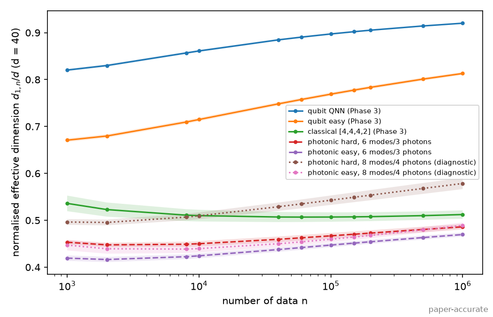
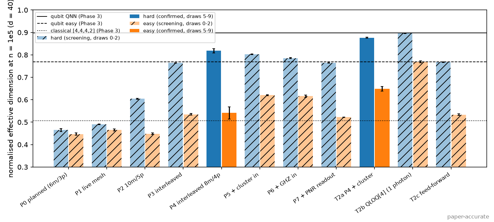

# The power of quantum neural networks - Reproduction

Status: Phase 04 complete (2026-10-22). All paper experiments except the IBM hardware run have been reproduced (Phase 03), and a native photonic MerLin adaptation has been evaluated (Phase 04).

## Reference and Attribution

- Paper: The power of quantum neural networks (Nature Computational Science 1, 403-409, 2021)
- Authors: Amira Abbas, David Sutter, Christa Zoufal, Aurelien Lucchi, Alessio Figalli, Stefan Woerner
- arXiv: https://arxiv.org/abs/2011.00027
- Original repository: https://github.com/amyami187/effective_dimension, tag v1.0.0 (Zenodo 10.5281/zenodo.4732830), Apache-2.0.
- License and attribution notes: cite the paper below. No upstream code is copied; `lib/` re-implements the models in PyTorch and is validated against the authors' published arrays.

## Original Paper

The paper asks whether quantum neural networks (QNNs) can be more expressive and
trainable than comparable classical neural networks. It introduces the
effective dimension, a capacity measure built from the Fisher information
matrix over the parameter space, links it to a generalization bound, and
compares the Fisher eigenvalue spectra of a classical feed-forward network, an
"easy" quantum model, and a QNN with a ZZ feature map. It reports that the QNN
reaches a higher effective dimension, has a more uniform Fisher spectrum, and
trains faster on Iris, including on IBM quantum hardware.

## Reproduction Scope (incuding Updates and Deviations)

The claim and experiment inventories are in `LOG.md`.
- **Planned paper experiments:**
  - Fig. 2 and Fig. 3a (Fisher spectra and effective dimension at d=40);
  - Fig. 9 (spectra at s_in = 6, 8, 10);
  - Fig. 8 (sample-size sensitivity);
  - Fig. 3b and Table 1 (Iris training loss and Fisher-Rao norm at d=8);
  - Fig. 6 (effective dimension vs label randomization).
- **Not reproduced:** the IBM ibmq_montreal hardware run (no QPU access). The generalization
  bound (Theorems 3.2 and B.5) is documented, not tested.

Implementation choices and deviations:
- **Framework:** the circuits are re-implemented as a batched PyTorch statevector simulator
  (no Qiskit) with Qiskit 0.23 conventions:
  - `ZZFeatureMap` and `ZFeatureMap` with `P(2x)` phases, and the Hadamard layer repeated
    in every repetition;
  - `RealAmplitudes` with full entanglement;
  - parity readout.
- **Validation (V-00):** fed the authors' random draws, this reproduces their cached Fig. 2
  F_hat arrays element-wise to about 1e-14. Appendix A's "Hadamards once" reading does
  *not* reproduce them.
- **Gradients:** exact autograd instead of parameter shift for the Fisher (mathematically
  identical, verified in tests). Exact autograd also replaces the authors' forward finite
  differences (step 1e-10) for quantum training. The finite-difference variant is kept as
  ablation A-04.
- **Parameter domain:** the authors' code samples theta from U[0,1], while the paper states
  [-1,1]. Both are configured (`*_original` vs `*_paper_domain`).
- **Classical baselines:** the authors' classical networks are bias-free, with leaky-ReLU
  hidden layers and softmax(tanh) for the Fisher. Extra fair baselines are configured:
  - a topology search at d=40 (`topology_search_*`);
  - the d=8 linear softmax model [4,2] (`training_iris_classical.json`).
- **Iris:** all models train on the same 100 points (the authors' quantum scripts used 98).
- **Loss curves:** they store L(theta_0..theta_T), i.e. T+1 values. The authors' torch loop
  stored the first T values and their Qiskit ADAM the last T.

## Install and How to Run

```bash
pip install -r papers/power_of_QNN/requirements.txt

# From the repo root
python implementation.py --paper power_of_QNN --help
python implementation.py --paper power_of_QNN                                   # smoke run (defaults.json)
python implementation.py --paper power_of_QNN --config configs/reference_check.json

# From inside papers/power_of_QNN
python ../../implementation.py --config configs/effdim_d40_original.json
```

Quick smoke commands (seconds, not paper results):

```bash
python implementation.py --paper power_of_QNN
python implementation.py --paper power_of_QNN --config configs/training_iris_original.json --iterations 3 --seeds-count 3
python implementation.py --paper power_of_QNN --config configs/generalisation_reduced.json --iterations 20 --seeds-count 2
```

Paper-scale runs (all GREEN tier: minutes on a laptop CPU, or on a CUDA GPU with `--device cuda`):

| Config | Experiment |
|---|---|
| `reference_check.json` | V-00: comparison with the authors' cached arrays |
| `effdim_d40_original.json` | Fig. 2, Fig. 3a, rank limit (E-01, E-02, E-08) |
| `effdim_d40_paper_domain.json` | A-01: theta ~ U[-1,1] |
| `effdim_d40_easy_ry.json` | A-03: RY angle encoding for the easy model |
| `spectrum_scaling_original.json` | Fig. 9 (E-04) |
| `sensitivity_classical.json` | Fig. 8 (E-05) |
| `topology_search_d40_classical.json`, `topology_search_d40_relu_classical.json` | Fair classical baseline search (B-1, A-02) |
| `training_iris_original.json` | Fig. 3b, Table 1 (E-03, E-03b) |
| `training_iris_finite_difference.json` | A-04: finite-difference quantum gradients |
| `training_iris_paper_domain.json` | A-01 for training: init U[-1,1] |
| `training_iris_classical.json` | B-2: d=8 classical baselines; set `--lr` per grid point |
| `generalisation_original.json`, `generalisation_reduced.json` | Fig. 6 (E-06), full and reduced |

## Configuration

- `configs/defaults.json`: a lightweight smoke config (Fig. 2/3a pipeline with 4 parameter
  sets x 8 inputs). Named configs overlay it; lists such as `models` are replaced, not merged.
- `cli.json` is the authoritative paper-specific CLI schema: `--num-thetas`, `--num-inputs`,
  `--iterations`, `--lr`, `--seeds-count`.
- Global flags (`--config`, `--outdir`, `--seed`, `--dtype`, `--device`, `--log-level`,
  `--data-root`) come from the shared runtime. `dtype` must be float64, and MPS is rejected
  because it has no float64.
- `experiment.kind` selects the experiment: `reference_check`, `fisher_effective_dimension`,
  `sensitivity`, `topology_search`, `training`, or `generalisation`.

Each run writes `outdir/run_YYYYMMDD-HHMMSS/` with:
- `run.log`, `config_snapshot.json`, `run_status.json`, `metrics.json`;
- per-model arrays (`fisher_<model>.npz`, `sensitivity_<model>.npz`, `training_<model>.npz`,
  `generalisation.npz`);
- figures (`fig_*.png`).

## Data

All data used by the paper is public and small; no download or login is required.

| Dataset | Use | Local path (repo-relative) | Status |
|---|---|---|---|
| Iris, classes 0/1 (rows 0:100, L2 row-normalised) | Fig. 3b / Table 1 training, Fisher-Rao norm | `data/power_of_QNN/iris/` | Original (scikit-learn 1.9.1 bundled `iris.csv`, same `load_iris` path as the authors) |
| make_blobs (1000 x 6, 2 centres, `random_state=42`, 60/40 split `random_state=0`) | Fig. 6 generalisation | `data/power_of_QNN/make_blobs/` | Original generator, regenerated with scikit-learn 1.9.1; bit-identity with the authors' version cannot be checked |
| N(0, I) inputs, uniform parameter samples | Fisher / effective dimension | generated per run (seeded) | n/a |
| Authors' figure arrays (`.npy`) | Numeric reference targets | `data/power_of_QNN/sources/effective_dimension/` (tag v1.0.0) | Original |

Each data folder has a `MANIFEST.json` with SHA-256 checksums, shapes and class counts.
The exact regeneration command is in `LOG.md` (Data Acquisition Log). Licenses: Iris CC BY 4.0
(UCI), scikit-learn BSD-3-Clause, upstream code Apache-2.0.

## Results Obtained and Comparison with the Paper

Phase 03 (2026-10-21).
- **Scope:** all results are **paper-accurate**: the authors' settings and full data, with
  multiple draws or seeds (more than the paper's single draw for the Fisher experiments).
- **Hardware:** runs were on NVIDIA L4 GPUs (float64). GPU and CPU agree to 5e-14.
- **Provenance:** every number below comes from `results/phase03_tables.md`, generated by
  `python utils/summarize_results.py --runs results/phase03_runs.json --output results/phase03_tables.md`.
  `results/phase03_runs.json` lists the run directory of each experiment.
- **Paper values:** taken from the paper's Table 1 and from the authors' published source data
  (git tag v1.0.0).

### Effective dimension (Fig. 3a; d=40, s_in=4; 5 draws of 100 theta x 100 inputs)

| Model | ours, n=1e3 | paper, n=1e3 | ours, n=1e6 | paper, n=1e6 | Agreement |
|---|---|---|---|---|---|
| QNN (ZZFeatureMap reps 2 + RealAmplitudes reps 9) | 0.8203 ± 0.0025 | 0.8211 | 0.9201 ± 0.0014 | 0.9211 | quantitatively reproduced |
| Easy model (ZFeatureMap reps 1 + RealAmplitudes reps 9) | 0.6708 ± 0.0039 | 0.6744 | 0.8130 ± 0.0033 | 0.8146 | quantitatively reproduced |
| Classical [4,4,4,2] (stated model) | 0.5361 ± 0.0166 | 0.5143 | 0.5123 ± 0.0090 | 0.6106 | **not reproduced**: the published curve is the d=28 network [4,4,2,2] (we reproduce it within 0.003) |


**Ordering:** QNN > easy > classical holds at every n. It also holds:
- with parameters drawn from the paper's [-1,1] instead of the code's [0,1]
  (`results/fig3a_effective_dimension_d40_paper_domain.png`); the classical network rises to
  0.57 -> 0.67;
- against every bias-free classical topology with d=40 and at most 3 hidden layers. The best
  is [4,6,2,2] at 0.55 (n=1e5), or 0.71 with ReLU and the [-1,1] domain.

Footnote 18's choice of [4,4,4,2] as the highest-rank classical network is not reproduced:
[4,6,2,2] has mean rank 31.0 vs 22.6.

### Fisher spectra (Figs. 2 and 9)

- **Normalized spectra:** the classical F_hat is degenerate (43% of eigenvalues < 1e-10). The
  QNN spectrum is the most uniform: its max eigenvalue stays ~4.5-5.8 from 4 to 10 qubits,
  while the easy model's outliers grow to ~54.
- **Match with the authors' arrays:** at 6, 8 and 10 qubits our quantum F_hat equal the
  authors' cached Fig. 9 arrays element-wise (<= 3e-14).
  (`results/fig2_spectra_d40.png`, `results/fig9_spectra_s{6,8,10}.png`)
- **Not visible in the paper's normalized plots:** the per-parameter unnormalized Fisher trace,
  which Sec. 3.4 ties to barren plateaus, shrinks by about half per qubit for the QNN (x0.49)
  as well as for the easy model (x0.53). The claimed barren-plateau resilience of the QNN is
  therefore **not supported**. See `results/fisher_trace_scaling.png` and `INSIGHTS.md` I-02.


### Training on Iris (Fig. 3b, Table 1; d=8, 100 seeds, Adam lr 0.1, 100 iterations)

| Model | final loss, ours | final loss, paper | Fisher-Rao norm, ours | Fisher-Rao norm, paper |
|---|---|---|---|---|
| QNN | 0.2316 ± 0.0079 | 0.2314 | 115.6 ± 113.4 | 117.84 |
| Easy model | 0.4322 ± 0.0317 | 0.4305 | 109.9 ± 136.5 | 104.89 |
| Classical [4,1,1,1,2] | 0.3891 ± 0.1250 | 0.379 | 63.3 ± 156.6 | 46.45 |


- **Final losses:** quantitatively reproduced. Exact gradients and the authors' finite
  differences differ by <= 3e-4.
- **Init range:** with every model initialized in [-1,1], the QNN still has the lowest loss
  (0.2307 ± 0.0062) and the classical network improves to 0.3029 ± 0.1650.
- **Fisher-Rao norm:** its ordering **reverses** under that init range (QNN 9.7, classical
  259.9). The paper's "~250% higher" therefore reflects the larger quantum init range, not
  capacity (`INSIGHTS.md` I-03).
- **Pending:** a learning-rate-tuned comparison that includes the linear d=8 model [4,2] is
  scheduled for Phase 05.

### Generalization (Fig. 6; [6,110,2], d=880, 10 runs per level)

| Labels overwritten at random | realized flips | ours | authors' cached data |
|---|---|---|---|
| 0% | 0% | 0.0832 ± 0.0068 | 0.0838 ± 0.0049 |
| 10% | 5.2% | 0.1038 ± 0.0074 | 0.1041 ± 0.0073 |
| 20% | 10.6% | 0.1593 ± 0.0115 | 0.1537 ± 0.0111 |
| 30% | 15.7% | 0.1941 ± 0.0105 | 0.1943 ± 0.0094 |
| 40% | 20.7% | 0.2130 ± 0.0151 | 0.2067 ± 0.0162 |


These are quantitatively reproduced. Note that "x% randomized" overwrites x% of the labels
with random ones, so only about x/2% actually change.

### Sample-size sensitivity (Fig. 8)

The estimate stabilizes by about 40 samples for d <= 40. For the d=60-100 classical networks of
Fig. 9 it is still rising at 100 samples, in our data and in the authors' (`results/fig8_sensitivity.png`).

### Claim verdicts (Phase 03)

| Claim | Verdict |
|---|---|
| QNN has a higher effective dimension than comparable classical and easy models (Fig. 3a) | supported; the published classical curve uses a d=28 network |
| QNN Fisher spectrum is the most uniform; classical is degenerate (Fig. 2) | supported |
| QNN resists barren plateaus as qubits grow (Fig. 9, Sec. 4.3) | partially supported: normalized shape yes; unnormalized Fisher scale vanishes exponentially |
| QNN trains to a lower loss (Fig. 3b, Table 1) | supported against the paper's baselines; tuned baselines pending (Phase 05) |
| QNN has a ~250% higher Fisher-Rao norm (Table 1) | unsupported as a capacity statement (init-range artifact) |
| Effective dimension tracks generalization (Fig. 6) | supported |
| 100 samples suffice for d <= 100 (Fig. 8) | partially supported (d <= 40 only) |
| Generalization bound (Thms 3.2, B.5) | not tested (theory) |
| QNN trains better on IBM hardware | not tested (no QPU) |

## Photonic Adaptation (MerLin, Phase 04)

**Photonic translation status: `MERLIN_IMPLEMENTATION`.** This is an *adaptation*, not part
of the reproduction.

**Model.** Following the user's direction, there is no 1-to-1 qubit/gate mapping: dual-rail
CNOTs would cost extra modes and photons. Instead, `lib/photonic_merlin.py` is a native
linear-optical classifier on m = s_in + 2 modes with m/2 photons:
- **Easy encoding:** a fixed balanced mixer, then phases 2x_i.
- **Hard encoding:** the paper's ZZFeatureMap data map, i.e. 2x_i and 2(pi-x_i)(pi-x_(i+1))
  phases between fixed mixers, repeated twice (data re-uploading).
- **Trainable part:** an MZI mesh truncated to exactly d phases.
- **Readout:** parity of threshold clicks on the odd modes.

It is simulated in MerLin's FOCK space with ideal threshold detection and no postselection,
and exercised through the same Fisher, effective-dimension and training pipelines as Phase 03.
Hardware-aware details for every run are in `LOG.md` ("Phase 04 Results").

| Quantity (d=40, s_in=4, theta ~ U[0,1], 5 draws) | n=1e3 | n=1e6 | mean rank |
|---|---|---|---|
| photonic hard (6 modes / 3 photons) | 0.4532 ± 0.0045 | 0.4861 ± 0.0058 | 24.0 / 40 |
| photonic easy (6 modes / 3 photons) | 0.4194 ± 0.0057 | 0.4697 ± 0.0042 | 24.0 / 40 |
| photonic hard (8 modes / 4 photons, diagnostic amendment) | 0.4964 ± 0.0061 | 0.5786 ± 0.0120 | 33.6 / 40 |
| qubit QNN (Phase 03) | 0.8203 ± 0.0025 | 0.9201 ± 0.0014 | 40 / 40 |
| classical [4,4,4,2] (Phase 03) | 0.5361 ± 0.0166 | 0.5123 ± 0.0090 | 22.7 / 40 |



**What carries over to photonics:**
- **Encoding effect:** the hard (higher-order, re-uploaded) encoding has a higher effective
  dimension than the easy one at s_in = 4 (n <= 1e5) and s_in = 6. It also trains to a lower
  Iris loss: 0.377 ± 0.055 vs 0.546 ± 0.046 (100 seeds).
- **Not robust at larger sizes:** the encoding effect is not resolved at s_in = 8 or 10.
- **Fisher scale:** it vanishes exponentially with size, as for the qubit models: x0.47 per
  added input vs x0.49 for the qubit QNN (`results/merlin_fisher_trace_scaling.png`).

**What does not carry over (planned 6-mode design; see the design study below for improved designs):**
- **Capacity advantage over classical networks:** on the 6-mode chip the photonic models stay
  below classical [4,4,4,2], because d=40 exceeds what 6 modes can use (rank ~24). With 8 modes
  the hard model passes [4,4,4,2] but only ties the best classical topology.
- **Trainability advantage over classical networks:** photonic hard 0.377 vs classical 0.389,
  difference not resolved (`results/merlin_training_iris.png`).

**Design study (user-requested, 2026-10-24; exploratory screening plus confirmation on fresh
draws).** See `results/merlin_design_study.png` and LOG.md, Amendments 2 and 3.

| Photonic design (d=40) | ed/d at n=1e5 | vs qubit QNN (0.897) |
|---|---|---|
| planned (6 modes / 3 photons) | 0.467 | far below |
| interleaved re-uploading, 8 modes / 4 photons (P4, confirmed) | 0.818 ± 0.009 | −0.08 |
| P4 + **linear-cluster input from a spin emitter** (T2a, confirmed) | **0.877 ± 0.002** | −0.02 (tie at n=1e3) |
| feed-forward (mid-circuit PNR + conditional meshes, 6 modes) | 0.767 | −0.13 |
| **QLOQ [4]**: the paper's exact QNN as 1 photon in 16 modes (arXiv:2411.03878) | 0.896 (identical F_hat) | 0 |



**Beating the qubit QNN (Amendment 4, user request; exploratory search, confirmed on fresh draws
10-14).**
- **Design (A8):** 10 modes, 5 photons, a **linear-cluster input from a spin emitter**,
  **3 interleaved re-uploads** of the paper's data map, and a 40-phase live MZI mesh.
- **Result:** normalized effective dimension 0.8455 / 0.9096 / 0.9295 (n = 1e3 / 1e5 / 1e6).
  The qubit QNN with the same data-map depth (ZZ ×3) reaches 0.8137 / 0.8926 / 0.9165 on the
  same draws.
- **Margin:** +0.013 to +0.032, above 3 std at every n. A8 also beats the paper's ZZ ×2 QNN.
- **Not robust everywhere:** with parameters in [0, 2π], the best photonic design only ties
  the qubit model.
- **Caveats:** this is a capacity metric, not accuracy (A8 was not trained); the photons are
  ideal and the results simulated; the photonic Fock space is larger (2002 states, against 16
  qubit amplitudes).

- **What lifts the photonic score:** data re-uploading interleaved with trainable meshes (the
  largest gain), more modes, an entangled emitter input, and fixing dead phases in the mesh.
- **What does not help:** feed-forward and PNR readout.
- **Best multi-photon design:** essentially matches the qubit QNN, and beats every classical
  network searched by +0.28 to +0.39.
- **QLOQ shows** that the paper's 4-qubit QNN *is* a single-photon interferometer. Its capacity
  therefore needs no multi-photon quantum effect.
- **Trainability does not follow:** the capacity-optimized 8-mode layout trains worse at d=8
  (Iris loss 0.588, vs 0.377 for the planned design and 0.389 for classical).

**Ablations:**
- MerLin's `UNBUNCHED` space postselects collision-free outcomes, keeping only 37-43% of
  events, and renormalizes. It raises the effective dimension slightly.
- Sampling theta in [0, 2pi] raises the effective dimension but not the rank.

Full tables: `results/phase04_tables.md`.

**Confidence: MEDIUM.** The conclusions depend on chip size, readout and mixer layout. All
results are simulated (ideal lossless photons); there was no QPU run.

## Limitations

- The IBM hardware run is not reproduced (no QPU access).
- Classical Fisher arrays can only be compared with the authors' in distribution, not
  element-wise.
- make_blobs was regenerated with scikit-learn 1.9.1, so bit-identity with the authors' 2020
  data cannot be checked.
- Fig. 9 classical effective dimensions (d=60-100) are underestimated: the 100-sample Monte
  Carlo estimate has not converged.
- App. A's [-1,1] feature scaling for the Fisher inputs was not ablated. The authors' arrays,
  which we match, use N(0,1).
- The photonic adaptation (Phase 04) is simulated with ideal photons and one readout and chip
  design. The learning-rate-tuned fair baselines are pending (Phase 05).

## Tests

```bash
cd papers/power_of_QNN
pytest -q
```

The 47 tests cover:
- circuit conventions (CX action, Qiskit entanglement order);
- autograd vs parameter shift;
- the Fisher as an explicit per-sample sum;
- the effective-dimension rank limit;
- V-00 against the authors' arrays (skipped with a reason if the upstream cache is absent);
- topology enumeration;
- Adam equivalence with `torch.optim.Adam`;
- finite differences vs autograd;
- independence of per-seed training;
- CLI wiring;
- end-to-end smoke runs;
- the MerLin photonic models (Phase 04): an independent Perceval SLOS check of the photonic
  classifier, UNBUNCHED = renormalized collision-free FOCK, gradient flow and per-row
  independence, dead vs live mesh phases, the interleaved split, PNR vs click parity, emitter
  inputs (gradients and an explicit GHZ state), QLOQ [n] equal to the qubit QNN, and the
  feed-forward Fisher against finite differences. The emitter tests are skipped when MerLin
  lacks `EmitterState` (the PyPI build).

## Citation and License

```bibtex
@article{abbas2021power,
  title   = {The power of quantum neural networks},
  author  = {Abbas, Amira and Sutter, David and Zoufal, Christa and Lucchi, Aurelien and Figalli, Alessio and Woerner, Stefan},
  journal = {Nature Computational Science},
  volume  = {1},
  pages   = {403--409},
  year    = {2021},
  doi     = {10.1038/s43588-021-00084-1}
}
```
