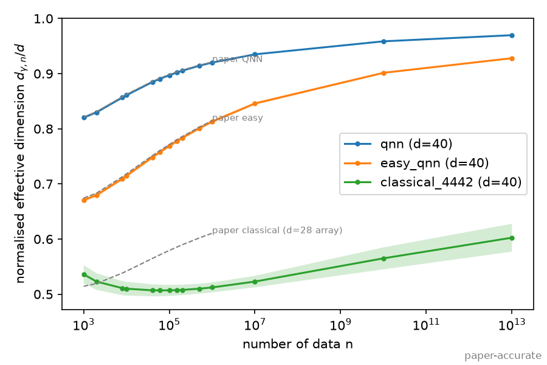
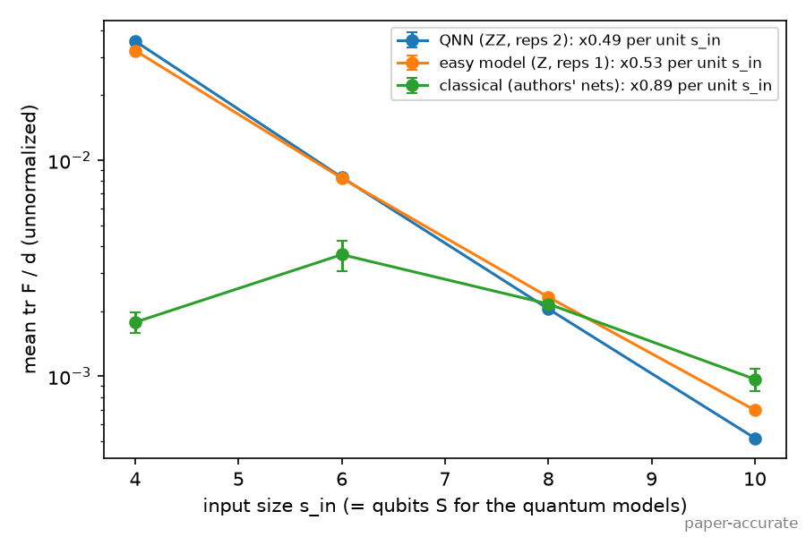
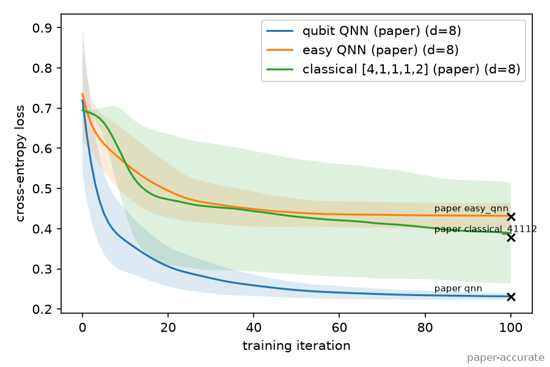
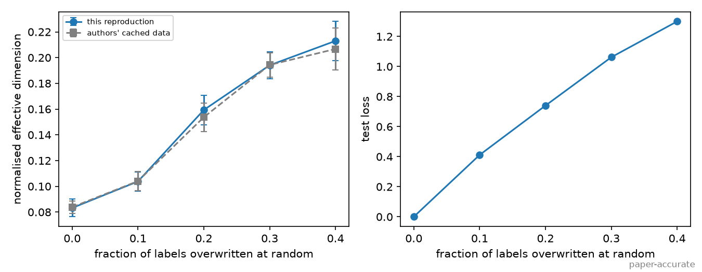
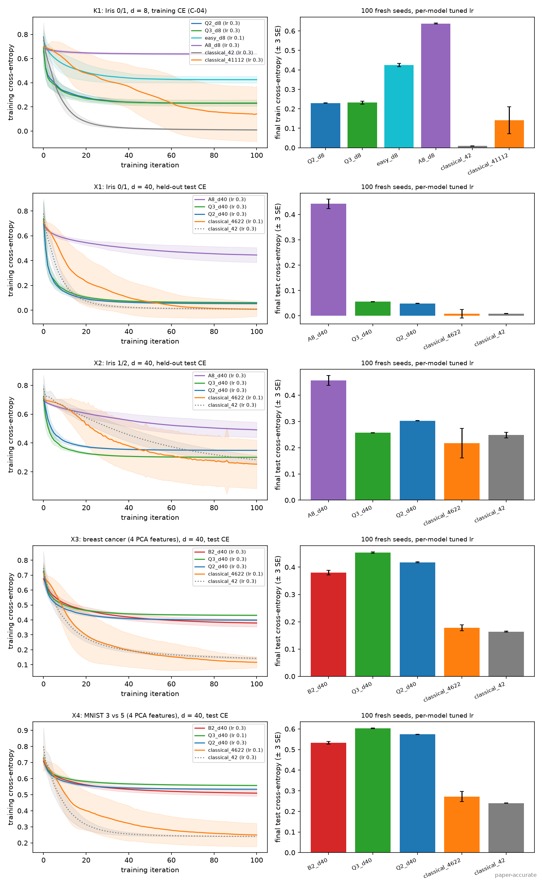

# The power of quantum neural networks — Reproduction

Status (2026-10-30): Phases 01-08 complete; model and task names made descriptive on 2026-10-30. Start with `notebook.ipynb`, a runnable
walkthrough of the claims and evidence (under a minute on CPU).
- **Reproduced:** every paper experiment except the IBM hardware run (Phase 03).
- **Photonic adaptation:** a native MerLin design was built and searched (Phase 04).
- **Fair comparison:** the quantum and classical models were compared fairly on Iris and on
  two harder tasks (Phase 05).

## Reference and Attribution

- Paper: The power of quantum neural networks (Nature Computational Science 1, 403-409, 2021)
- Authors: Amira Abbas, David Sutter, Christa Zoufal, Aurelien Lucchi, Alessio Figalli, Stefan Woerner
- arXiv: https://arxiv.org/abs/2011.00027
- Original repository: https://github.com/amyami187/effective_dimension, tag v1.0.0 (Zenodo 10.5281/zenodo.4732830), Apache-2.0.
- License and attribution notes: cite the paper below. No upstream code is copied; `lib/` re-implements the models in PyTorch and is validated against the authors' published arrays.

## Original Paper

The paper asks whether quantum neural networks (QNNs) can be more expressive and
trainable than comparable classical neural networks.
- **Measure:** it introduces the *effective dimension*, a capacity measure built from the
  Fisher information matrix over the parameter space, and links it to a generalization bound.
- **Models compared:**
  - a classical feed-forward network;
  - an "easy" quantum model (Z feature map);
  - a QNN with a ZZ feature map.

  All have d = 40 parameters, 4 inputs and 2 outputs.
- **Claims:**
  - the QNN has a higher effective dimension and a more uniform Fisher spectrum;
  - it resists barren plateaus;
  - it trains to a lower loss on Iris, including on IBM quantum hardware.

## Reproduction Scope, Claims, and Deviations

The full claim and experiment inventories are in `LOG.md`.

**Reproduced (Phase 03, paper-accurate):**
- Fig. 2 and Fig. 3a (Fisher spectra and effective dimension at d=40);
- Fig. 9 (spectra at s_in = 6, 8, 10);
- Fig. 8 (sample-size sensitivity);
- Fig. 3b and Table 1 (Iris training loss and Fisher-Rao norm at d=8);
- Fig. 6 (effective dimension vs label randomization).

**Not reproduced:**
- the IBM ibmq_montreal hardware run (no QPU access);
- the generalization bound (Theorems 3.2, B.5), which is documented but not testable as stated.

**Added beyond the paper:**
- a native photonic (MerLin) adaptation and design search (Phase 04);
- a fair, learning-rate-tuned comparison on Iris, breast cancer and MNIST 3 vs 5 (Phase 05).

| Claim | Verdict |
|---|---|
| C-01: the QNN has a higher effective dimension than comparable classical and easy models (Fig. 3a) | **supported**; the published classical curve is a d=28 network |
| C-02: the QNN Fisher spectrum is the most uniform; the classical one is degenerate (Fig. 2) | **supported** |
| C-03: the QNN resists barren plateaus as qubits grow (Fig. 9, Sec. 4.3) | **partially supported**: the normalized shape holds, but the unnormalized Fisher scale vanishes exponentially |
| C-04: the QNN trains to a lower loss than the classical net (Fig. 3b, Table 1) | Table 1 reproduced, but **unsupported** under fair tuning: both d=8 classical nets reach lower loss (Phase 05) |
| C-05: the QNN has a ~250% higher Fisher-Rao norm (Table 1) | values reproduced; **unsupported** as a capacity statement (it reverses with the init range) |
| C-07: effective dimension tracks generalization (Fig. 6) | **supported** |
| C-08: effective dimension tends to the Fisher rank as n grows | **supported** |
| C-11: 100 samples suffice for d <= 100 (Fig. 8) | **partially supported** (d <= 40 only) |
| C-06: generalization bound (Thms 3.2, B.5) | not tested (theory) |
| C-10: QNN trains as well on IBM hardware | not tested (no QPU) |

**Model and task names.** This README uses the descriptive names below. Configs, run folders and
result tables use the code names in the second column (a `_d8` / `_d40` suffix gives the number
of trainable parameters d); they are only needed to trace a number back to its run.

| Name | Code names in runs | What it is |
|---|---|---|
| qubit QNN (paper) | `qnn`, `Q2_d8`, `Q2_d40`, `Q2_qubit_qnn` | The paper's quantum neural network: 4 qubits, ZZ feature map applied twice, then a trainable RealAmplitudes ansatz (RY layers, full CNOT entanglement), parity readout. |
| qubit QNN, 3 uploads | `Q3_d8`, `Q3_d40`, `Q3_qubit_qnn_reps3` | The same circuit with the ZZ feature map applied 3 times: the qubit counterpart of the photonic designs that upload the data 3 times. |
| easy QNN (paper) | `easy_qnn`, `easy_d8` | The paper's "easy" model: Z feature map (no entangling terms) and the same ansatz. |
| classical [a,b,...] | `classical_41112`, `classical_4442`, `classical_4622` | Bias-free feed-forward network; the numbers are the layer widths from 4 inputs to 2 outputs. [4,1,1,1,2] and [4,4,4,2] are the paper's d=8 and d=40 networks; [4,6,2,2] is the best d=40 network of the classical topology search. |
| linear [4,2] | `classical_42` | Linear softmax classifier (d=8). |
| photonic planned design | `photonic_hard`, `photonic_easy`, `P0_hard`, `P0_easy` | The Phase 04 plan before any search: 6 modes, 3 photons in a Fock state, data encoded once, then a trainable mesh. |
| **photonic 10-mode** | `A8_d8`, `A8_d40`, `A8_10m_cluster_reps3` (same circuit as `B6_10m_cluster`) | MerLin model: 10 optical modes, 5 photons from a cluster-state emitter, data uploaded 3 times between trainable meshes. Selected for the highest effective dimension. |
| **photonic 6-mode** | `B2_d40`, `B2_6m_cluster` | The same design on 6 modes with 3 photons. Selected on effective dimension and validation loss together. |
| other photonic candidates | `P*`, `T2*`, `A*`, `B*` | Candidates of the four photonic design searches: `P1`-`P7` = search 1 (circuit layout), `T` = search 2 (input states and encodings), `A` = search 3 (chip size and input), `B` = search 4 (capacity and loss together). `lib/display_names.py` spells each one out (modes, input, uploads). |

| Task | Config | What is compared |
|---|---|---|
| Iris 0/1, d=8 (the paper's Table 1 task) | `fair_iris01_d8` | final training loss, learning rate tuned per model |
| Iris 0/1 and Iris 1/2 (Iris 1/2 is not linearly separable), held-out, d=40 | `fair_iris01_d40`, `fair_iris12_d40` | test loss |
| breast cancer and MNIST 3 vs 5, held-out, d=40 | `fair_bcancer_d40`, `fair_mnist35_d40` | test loss and accuracy; both reduced to 4 PCA features |

B-1 and B-2 are the fair classical baselines: B-1 is the search over every d=40 classical
topology (Phase 03), B-2 the learning-rate-tuned baselines of Phase 05. C-xx are the paper's
claims (table above), A-0x ablations of the paper reproduction, and V-00 the check against the
authors' cached arrays.

**Implementation choices and deviations:**
- **Framework:** the circuits are re-implemented as a batched PyTorch statevector simulator
  (no Qiskit), with Qiskit 0.23 conventions:
  - `ZZFeatureMap` / `ZFeatureMap` with `P(2x)` phases, and the Hadamard layer repeated in
    every repetition;
  - `RealAmplitudes` with full entanglement;
  - parity readout.
- **Validation (V-00):** fed the authors' random draws, this reproduces their cached Fig. 2
  F_hat arrays element-wise to about 1e-14. Appendix A's "Hadamards once" reading does not.
- **Gradients:** exact autograd replaces parameter shift for the Fisher (mathematically
  identical, verified in tests) and the authors' forward finite differences for quantum
  training. Finite differences are kept as ablation A-04.
- **Parameter domain:** the authors' code samples theta from U[0,1]; the paper says [-1,1].
  Both are configured (`*_original` vs `*_paper_domain`).
- **Iris:** all models train on the same 100 points; the authors' quantum scripts used 98.
- **Loss curves:** they store L(theta_0..theta_T). The authors' torch loop stored the first
  T values and their Qiskit ADAM the last T.
- **Fair comparison (Phase 05):** every model gets the same Adam optimizer, init U[-1,1] and
  100 iterations, plus its own learning rate selected on held-out data. This deliberately
  departs from the paper's single shared lr 0.1, two optimizers and mixed init ranges.

## Project Layout

```text
papers/power_of_QNN/
|-- README.md, LOG.md, INSIGHTS.md, FEEDBACK.md, VISITED_URLS.md, CONFLUENCE.md
|-- requirements.txt, cli.json, notebook.ipynb
|-- configs/            JSON configs (defaults, paper runs, ablations, MerLin, fair_* comparisons)
|-- lib/
|   |-- runner.py       train_and_evaluate(cfg, run_dir): dispatch on experiment.kind
|   |-- quantum.py      qubit QNN / easy model (statevector)
|   |-- classical.py    bias-free feed-forward networks, topology enumeration
|   |-- fisher.py, fisher_experiments.py      Fisher, effective dimension, spectra, searches
|   |-- training.py, training_experiments.py  seed-vectorized Adam training, Fig. 6
|   |-- fair_comparison.py                    Phase 05 lr grid + selection + fresh seeds
|   |-- photonic_merlin.py, qloq_merlin.py, feedforward_merlin.py   MerLin adaptations
|   |-- data.py, models.py, plotting.py, reference.py, experiment_logging.py
|   |-- display_names.py                      readable model and task names for figures and tables
|-- tests/              66 tests (pytest)
|-- utils/              table, figure and data-preparation scripts
|-- results/            curated tables (*.md, *.json) and figures (*.png)
|-- models/             empty: no trained model is kept
`-- outdir/             raw run directories (not committed)
```

## Install and How to Run

```bash
pip install -r papers/power_of_QNN/requirements.txt

# From the repo root
python implementation.py --paper power_of_QNN --help
python implementation.py --paper power_of_QNN                                   # smoke run (defaults.json)
python implementation.py --paper power_of_QNN --config configs/reference_check.json

# From inside papers/power_of_QNN
python ../../implementation.py --config configs/effdim_d40_original.json
```

Walkthrough notebook (fresh kernel, about 10 s on CPU):

```bash
cd papers/power_of_QNN
jupyter nbconvert --to notebook --execute --inplace notebook.ipynb
```

It loads stored results from `results/notebook_data.json` (regenerate with
`python utils/export_notebook_data.py --output results/notebook_data.json` when the run directories
are present). The live photonic cells need the MerLin fork with `EmitterState` and are skipped
otherwise.

Quick smoke commands (seconds, not results):

```bash
python implementation.py --paper power_of_QNN
python implementation.py --paper power_of_QNN --config configs/training_iris_original.json --iterations 3 --seeds-count 3
python implementation.py --paper power_of_QNN --config configs/fair_smoke.json
```

Full runs:

| Config | Experiment | Typical time |
|---|---|---|
| `reference_check.json` | V-00: comparison with the authors' cached arrays | seconds |
| `effdim_d40_original.json`, `effdim_d40_paper_domain.json`, `effdim_d40_easy_ry.json` | Fig. 2 / 3a; A-01; A-03 | ~1 min |
| `spectrum_scaling_original.json` | Fig. 9 | minutes |
| `sensitivity_classical.json` | Fig. 8 | ~1 min |
| `topology_search_d40_classical.json`, `topology_search_d40_relu_classical.json` | B-1 fair classical topology search | ~15 s |
| `training_iris_original.json`, `training_iris_finite_difference.json`, `training_iris_paper_domain.json` | Fig. 3b / Table 1; A-04; A-01 | ~1 min |
| `generalisation_original.json` (`_reduced`) | Fig. 6 | minutes |
| `effdim_d40_merlin*.json`, `spectrum_scaling_merlin.json`, `training_iris_merlin.json` | Phase 04 adaptation | 1-9 min |
| `design_*`, `tier3_*`, `tier4_*` | Phase 04 photonic design searches 1-4 | 1-98 min |
| `fair_iris01_d8.json` | Phase 05, Iris 0/1 at d=8 (C-04) | ~27 min |
| `fair_iris01_d40.json`, `fair_iris12_d40.json` | Phase 05, held-out Iris 0/1 and 1/2 | ~15 min each |
| `fair_bcancer_d40.json`, `fair_mnist35_d40.json` | Phase 05, breast cancer and MNIST 3 vs 5 | ~7 / ~11 min |
| `tier4_confirm_iris01.json`, `tier4_confirm_iris12.json` | photonic 6-mode under the held-out Iris 0/1 / 1/2 protocol | <1 min each |

Times are for a laptop CPU (the Phase 03/04 GPU runs used NVIDIA L4s with `--device cuda`).

**MerLin build:** configs with an emitter input (`input_kind: "cluster"` or `"ghz"`: the
design searches, the two photonic models and every `fair_*` config) need `ML.EmitterState`. That is in the local
`photonic_engines` MerLin fork (0.5.0.dev0), not in PyPI `merlinquantum` 0.4.x. The other
MerLin configs run with the PyPI build. The emitter tests are skipped when `EmitterState` is
missing.

Result tables and figures are regenerated from the run directories:

```bash
python utils/summarize_results.py --runs results/phase03_runs.json --output results/phase03_tables.md
python utils/summarize_merlin.py --runs results/phase04_runs.json --phase3-runs results/phase03_runs.json --output results/phase04_tables.md
python utils/summarize_design_screens.py --runs results/phase04_design_runs.json --output results/phase04_design_screens.md
python utils/summarize_fair_comparison.py --runs results/phase05_runs.json --output results/phase05_tables.md
python utils/summarize_fair_comparison.py --runs results/phase04_amendment5_runs.json --output results/phase04_amendment5_tables.md
python utils/plot_fair_comparison.py --runs results/phase05_runs.json --scope paper-accurate
```

## Configuration

- `configs/defaults.json`: a lightweight smoke config (Fig. 2/3a pipeline with 4 parameter
  sets x 8 inputs). Named configs overlay it; lists such as `models` are replaced, not merged.
- `cli.json` is the authoritative paper-specific CLI schema: `--num-thetas`, `--num-inputs`,
  `--iterations`, `--lr`, `--seeds-count`.
- Global flags (`--config`, `--outdir`, `--seed`, `--dtype`, `--device`, `--log-level`,
  `--data-root`) come from the shared runtime. `dtype` must be float64; MPS is rejected
  because it has no float64.
- `experiment.kind` selects the experiment: `reference_check`, `fisher_effective_dimension`,
  `sensitivity`, `topology_search`, `training`, `generalisation`, or `fair_comparison`.
- Model types (`models[].type`): `qubit`, `classical`, `photonic`, `qloq`, `feedforward`.
  Every key in `lib/models.py::build_model` is required.

Each run writes `outdir/run_YYYYMMDD-HHMMSS/` with:
- `run.log`, `config_snapshot.json`, `run_status.json`, `metrics.json`;
- per-model arrays (`fisher_<model>.npz`, `sensitivity_<model>.npz`, `training_<model>.npz`,
  `comparison_<model>.npz`, `generalisation.npz`);
- figures (`fig_*.png`).

## Data

Every dataset lives under `data/power_of_QNN/` (repository data root, `--data-root` or
`DATA_DIR`). Each folder has a `MANIFEST.json` with SHA-256 checksums that the loaders verify.

| Dataset | Use | Local path | Provenance and processing |
|---|---|---|---|
| Iris, classes 0/1 (rows 0:100, L2 row-normalized) | Fig. 3b / Table 1; Phase 05 at d=8 | `iris/iris_classes01_l2norm.npz` | scikit-learn 1.9.1 bundled `iris.csv`, the same `load_iris` path as the authors |
| Iris pairs 0/1 and 1/2, split 30/10/10 per class | Phase 05 held-out Iris | `iris/iris.csv` (split on the fly) | stratified per-class permutation, `RandomState(0)`; L2 per row |
| make_blobs (1000 x 6, 2 centres, `random_state=42`, 60/40 split `random_state=0`) | Fig. 6 | `make_blobs/` | original generator, regenerated with scikit-learn 1.9.1 |
| Breast Cancer Wisconsin (569 x 30) | Phase 05 breast cancer | `breast_cancer/bcancer_pca4_split_rs0.npz` | sklearn bundled copy. Stratified 60/20/20 per class, `RandomState(0)` -> 341 / 113 / 115. Standardize -> PCA 4 (80% of variance) -> min-max [0,1], all fit on train |
| MNIST digits 3 vs 5 | Phase 05 MNIST 3 vs 5 | `mnist/mnist35_pca4_train500_val500_test_rs0.npz` | OpenML `mnist_784` v1 (cached in `sources/openml/`, 16 MB). Train 500 + validation 500 drawn from the 60k training part, test = all 1,902 threes and fives of the 10k test part. Pixels/255 -> PCA 4 (34% of variance) -> min-max [0,1], fit on train |
| N(0, I) inputs, uniform parameter samples | Fisher / effective dimension | generated per run (seeded) | — |
| Authors' figure arrays (`.npy`) | numeric reference targets | `sources/effective_dimension/` (tag v1.0.0) | original |

Regeneration:
- Iris and blobs: the exact command is in `LOG.md` (Data Acquisition Log).
- Breast cancer and MNIST: `python papers/power_of_QNN/utils/prepare_datasets.py --data-root data`
  from the repository root.

Licenses: Iris and breast cancer CC BY 4.0 (UCI); MNIST CC BY-SA 3.0; scikit-learn
BSD-3-Clause; upstream code Apache-2.0.

## Results Obtained and Comparison with the Paper

Phase 03 (2026-10-21).
- **Scope:** all results are **paper-accurate**: the authors' settings and full data, with
  multiple draws or seeds.
- **Hardware:** NVIDIA L4 GPUs, float64. GPU and CPU agree to 5e-14.
- **Provenance:** every number comes from `results/phase03_tables.md`, generated from
  `results/phase03_runs.json`.
- **Paper values:** the paper's Table 1 and the authors' published source data (tag v1.0.0).

| Paper item | Claim tested | Paper value | Reproduced value | Delta | Metric agreement | Trend agreement | Claim support | Seeds | Comment |
|---|---|---:|---:|---:|---|---|---|---:|---|
| Fig. 3a, QNN, ed/d at n=1e3 / 1e6 | C-01 | 0.8211 / 0.9211 | 0.8203 ± 0.0025 / 0.9201 ± 0.0014 | −0.0008 / −0.0010 | quantitative | yes | supported | 5 draws | paper: 1 draw |
| Fig. 3a, easy model | C-01 | 0.6744 / 0.8146 | 0.6708 ± 0.0039 / 0.8130 ± 0.0033 | −0.0036 / −0.0016 | quantitative | yes | supported | 5 draws | |
| Fig. 3a, classical [4,4,4,2] | C-01 | 0.5143 / 0.6106 | 0.5361 ± 0.0166 / 0.5123 ± 0.0090 | +0.022 / −0.098 | **not reproduced** | ordering yes | supported (ordering) | 5 draws | the published curve is the d=28 [4,4,2,2], reproduced within 0.003 (I-01) |
| Fig. 2, F_hat spectra | C-02 | classical degenerate, QNN uniform | F_hat equal to the authors' arrays to ~1e-14 (quantum); classical 43% of eigenvalues < 1e-10 | N/A | quantitative (quantum), distributional (classical) | yes | supported | 5 draws | |
| Fig. 9, spectra at s_in = 6/8/10 | C-03 | QNN spectrum stays uniform | quantum F_hat equal to the authors' arrays (<= 3e-14); unnormalized tr F / d x0.49 per qubit | N/A | quantitative | normalized yes | partially supported | 3 draws | the paper shows normalized spectra only (I-02) |
| Fig. 3b / Table 1, QNN final loss | C-04 | 0.2314 | 0.2316 ± 0.0079 | +0.0002 | quantitative | yes | unsupported under fair tuning | 100 seeds | see Fair Baselines |
| Table 1, easy model final loss | C-04 | 0.4305 | 0.4322 ± 0.0317 | +0.0017 | quantitative | yes | — | 100 seeds | |
| Table 1, classical [4,1,1,1,2] final loss | C-04 | 0.3790 | 0.3891 ± 0.1250 | +0.0101 | quantitative (within std) | yes | — | 100 seeds | |
| Table 1, Fisher-Rao norm QNN / easy / classical | C-05 | 117.84 / 104.89 / 46.45 | 115.6 / 109.9 / 63.3 | −2.2 / +5.0 / +16.9 | within seed std (113-157) | yes | unsupported (reverses at init U[-1,1]: 9.7 / 6.9 / 259.9) | 100 seeds | I-03 |
| Fig. 6, ed/d at 0% / 40% random labels | C-07 | 0.0838 / 0.2067 (authors' cache) | 0.0832 ± 0.0068 / 0.2130 ± 0.0151 | −0.0006 / +0.0063 | quantitative | yes | supported | 10 runs | intermediate levels in the table below |
| Fig. 8, sample-size sensitivity | C-11 | 100 samples suffice for d <= 100 | stable by ~40 samples for d <= 40; still rising at 100 for d=60-100 | N/A | trend | partly | partially supported | 10 draws | the authors' arrays show the same |
| Remark 3.3, ed/d at n=1e13 | C-08 | -> rank / d | 0.970 / 0.928 / 0.603 (QNN / easy / classical) | N/A | — | yes | supported | 5 draws | |

### Effective dimension (Fig. 3a; d=40, s_in=4; 5 draws of 100 theta x 100 inputs)



**Ordering:** QNN > easy > classical holds at every n. It also holds:
- with parameters drawn from [-1,1] (`results/fig3a_effective_dimension_d40_paper_domain.png`);
- against every bias-free classical topology with d=40 and at most 3 hidden layers. The
  complete candidate table is in `results/phase03_tables.md` (B-1, 14 candidates x 3 draws,
  complete search). The best is [4,6,2,2], selected by mean rank 31.0 vs 26.1 for the
  runner-up (no tie), with ed/d 0.55 at n=1e5. With ReLU and the [-1,1] domain the rule
  again selects [4,6,2,2] (ed/d 0.68); the highest classical value there is 0.71, for
  [4,6,2,1,2], still below the easy model (0.77) and the QNN (0.90).

Footnote 18's choice of [4,4,4,2] as the highest-rank classical network is therefore not reproduced.

### Fisher spectra (Figs. 2 and 9)

- **Normalized spectra:** the classical F_hat is degenerate (43% of eigenvalues < 1e-10). The
  QNN spectrum is the most uniform: its max eigenvalue stays ~4.5-5.8 from 4 to 10 qubits,
  while the easy model's outliers grow to ~54.
- **Per-parameter unnormalized Fisher trace:** Sec. 3.4 ties this quantity to barren plateaus.
  It shrinks by about half per qubit for the QNN (x0.49) and the easy model (x0.53). The
  claimed barren-plateau resilience is therefore not supported.



### Training on Iris (Fig. 3b, Table 1; d=8, 100 seeds, Adam lr 0.1, 100 iterations)



- **Gradients:** exact gradients and the authors' finite differences differ by <= 3e-4.
- **Init range:** with every model initialized in [-1,1], the QNN still has the lowest loss
  under the paper's shared lr (0.2307 ± 0.0062 vs classical 0.3029 ± 0.1650). This changes once
  each model's lr is tuned (Fair Baselines).

### Generalization (Fig. 6; [6,110,2], d=880, 10 runs per level)

| Labels overwritten at random | realized flips | ours | authors' cached data |
|---|---|---|---|
| 0% | 0% | 0.0832 ± 0.0068 | 0.0838 ± 0.0049 |
| 10% | 5.2% | 0.1038 ± 0.0074 | 0.1041 ± 0.0073 |
| 20% | 10.6% | 0.1593 ± 0.0115 | 0.1537 ± 0.0111 |
| 30% | 15.7% | 0.1941 ± 0.0105 | 0.1943 ± 0.0094 |
| 40% | 20.7% | 0.2130 ± 0.0151 | 0.2067 ± 0.0162 |



"x% randomized" overwrites x% of the labels with random ones, so only about x/2% change.

## Fair Baselines

**Question:** does the paper's training advantage survive a fair comparison? And do the
photonic designs learn as well as their capacity suggests?

**Baseline state:**
- C-01/C-02: `FAIR_AND_REPRODUCED` (B-1 topology search, Phase 03).
- C-04: `MISSING_OR_UNFAIR`, because the paper's [4,1,1,1,2] is a width-1 chain, one untuned lr
  (0.1) is shared, and the init ranges differ. The fix is the B-2 baselines below.

**Protocol (frozen in `LOG.md` "Phase 5 Comparison Plan" before any run).** Every model gets:
- the same Adam optimizer (torch defaults), init U[-1,1], 100 full-batch iterations;
- its own lr from {0.01, 0.03, 0.1, 0.3}, selected on seeds 0-19 by the lowest mean final loss
  (training loss on Iris 0/1 at d=8, validation loss otherwise; ties within 0.005 reported);
- final numbers on fresh seeds 100-199.

A difference counts only if it exceeds both 0.005 and 3 standard errors.

| Run | Task | d | Selection split | Metric | Label |
|---|---|---|---|---|---|
| Iris 0/1, d=8 | all 100 points (the paper's setting) | 8 | train | final training CE | core (C-04) |
| Iris 0/1 and 1/2, held-out | 30/10/10 per class | 40 | validation | test CE | extension, advantage evidence |
| breast cancer, MNIST 3 vs 5 | 4 PCA features | 40 | validation | test CE (+ accuracy) | extension, advantage evidence |

Final cross-entropy, mean ± std over 100 fresh seeds; wall-clock in seconds for the lr grid
plus the final seeds, on a laptop CPU:

| Model | Iris 0/1, d=8: train CE | Iris 0/1: test CE | Iris 1/2: test CE | Breast cancer: test CE (acc) | MNIST 3 vs 5: test CE (acc) |
|---|---|---|---|---|---|
| Qubit QNN (paper) | 0.2297 ± 0.0024 | 0.0489 ± 0.0016 | 0.3027 ± 0.0020 | 0.418 ± 0.007 (0.878) | 0.574 ± 0.005 (0.719) |
| Qubit QNN, 3 uploads | 0.2316 ± 0.0253 | 0.0558 ± 0.0024 | 0.2567 ± 0.0027 | 0.454 ± 0.008 (0.863) | 0.603 ± 0.004 (0.700) |
| Easy QNN (paper) | 0.4250 ± 0.0269 | — | — | — | — |
| Photonic 6-mode (3 photons) | — | 0.0924 ± 0.0436 | 0.2360 ± 0.0397 | 0.380 ± 0.028 (0.906) | 0.533 ± 0.021 (0.824) |
| Photonic 10-mode (5 photons) | 0.6375 ± 0.0085 (d=8) | 0.4424 ± 0.0616 | 0.4562 ± 0.0623 | — | — |
| Classical [4,1,1,1,2] (paper, d=8) | 0.1416 ± 0.2308 | — | — | — | — |
| Classical [4,6,2,2] (B-1 selection) | — | 0.0083 ± 0.0560 | **0.2168 ± 0.1884** | 0.178 ± 0.035 (0.931) | 0.272 ± 0.082 (0.879) |
| Linear [4,2] (d=8; unmatched reference at d=40) | **0.0089 ± 0.0019** | 0.0087 ± 0.0020 | 0.2482 ± 0.0345 | **0.164 ± 0.006** (0.930) | **0.240 ± 0.002** (0.879) |

Wall-clock (s), held-out Iris 0/1 / Iris 1/2 / breast cancer / MNIST:
- qubit QNNs: 23-26 / 24-26 / 96-105 / 127-138;
- photonic 6-mode: 38 / 37 / 234 / 369;
- photonic 10-mode: 826 / 831 (Iris 0/1 at d=8: 1569);
- classical: <= 1 everywhere.



- **C-04 is unsupported under fair tuning.** At d=8 on the paper's own task, both classical nets
  reach a lower training loss than the QNN (linear 0.009 vs QNN 0.230, resolved). The QNN value
  matches Table 1. Even under the paper's own protocol (lr 0.1, init U[0,1]), the linear [4,2]
  reaches 0.041 against the QNN's 0.234 (live, 20 seeds, `notebook.ipynb` section 8). The paper's
  ordering therefore rests first on its choice of the width-1 [4,1,1,1,2] chain, then on the
  shared lr 0.1 and the all-positive classical init.
- **No learning advantage for any quantum model over classical baselines.** The classical models
  are better on Iris 0/1, breast cancer and MNIST. On Iris 1/2 the best quantum models (photonic
  6-mode, qubit QNN with 3 uploads) tie them.
- **Among quantum models, the photonic 6-mode model is the strongest learner.** It beats both
  qubit QNNs on Iris 1/2, breast cancer and MNIST
  (MNIST accuracy 0.824 vs 0.719) and loses to them only on the easy Iris 0/1.
- **Capacity does not predict learning here.** The photonic 10-mode model has the highest
  effective dimension and the
  worst held-out loss; the linear model has the lowest capacity and the best loss.
- **Learning-rate sweeps:** every model's full grid is in `results/phase05_tables.md`
  (5 runs x 4-6 models x 4 lr x 20 seeds; every sweep complete, coverage checked by the script).
  lr 0.3, the grid maximum, was selected or tied for most models. The grid was not extended
  after seeing results.

Every pairwise decision is in `results/phase05_tables.md` and `results/phase04_amendment5_tables.md`.

## Photonic Assessment and MerLin Extension

**Photonic translation status: `MERLIN_IMPLEMENTATION`.** Everything in this section is an
*adaptation* of the paper, not part of the reproduction. All results are exact simulations
with ideal, lossless photons.

**Mapping.** There is no 1-to-1 qubit/gate mapping: dual-rail CNOTs would cost extra modes
and photons (user direction). Instead, `lib/photonic_merlin.py` is a native linear-optical
classifier:
- **Inputs:** m modes and m/2 photons, with a Fock input [1,0,1,0,...] or an entangled
  linear-cluster input from one spin emitter.
- **Hard encoding:** the paper's data map, i.e. phases 2x_i and 2(pi-x_i)(pi-x_(i+1)) between
  fixed mixers. The **easy encoding** applies phases 2x_i only.
- **Trainable part:** an MZI mesh truncated to exactly d phases, either after the encoding or
  interleaved with re-uploads of the data.
- **Readout:** parity of threshold clicks on the odd modes.

**Results, in the order they were found:**

| Step | Design (d=40) | ED n=1e5 | Learning (test CE) | Source |
|---|---|---|---|---|
| Planned | 6 modes / 3 photons, encode then mesh | 0.467 | Iris 0/1 at d=8: 0.377 vs classical 0.389 (tie) | Phase 04 |
| Search 1: circuit layout | interleaved re-uploading, 8 modes / 4 photons | 0.818 ± 0.009 | worse at d=8 (0.588) | `phase04_design_screens.md` |
| Search 2: input states and encodings | the same + cluster-state input; QLOQ: the paper's QNN as 1 photon in 16 modes | 0.877; 0.896 (identical F_hat) | — | same |
| Search 3: chip size and input | **photonic 10-mode**: 10 modes / 5 photons, cluster input, 3 uploads | **0.9096 ± 0.0018** (beats the 3-upload qubit QNN 0.8926, >3 std at n=1e3-1e6) | worst of all models (0.44-0.46) | same; Phase 05 |
| Search 4: capacity and loss together | **photonic 6-mode**: 6 modes / 3 photons, cluster input, 3 uploads | 0.8970 ± 0.0007 (>= qubit up to n=1e5, tie at 1e6) | best quantum model on Iris 1/2, breast cancer, MNIST | `phase04_amendment5_tables.md`; Phase 05 |

**What carries over from the paper:**
- **Encoding effect:** the hard encoding gives a higher effective dimension and a lower Iris loss
  than the easy one at s_in = 4 (`results/phase04_tables.md`). It is not resolved at s_in = 8, 10.
- **Fisher scale:** it vanishes exponentially with size, as for the qubit models (x0.47 per added
  input vs x0.49).

**What the design searches showed.** Every candidate of every search is listed in
`results/phase04_design_screens.md`, with the predeclared rules in `LOG.md` (searches 1-4 are recorded there as Amendments 2-5).
- **Capacity levers:** data re-uploading interleaved with trainable meshes gave the largest gain.
  More modes and an emitter cluster input also help, and fixing dead mesh phases matters.
  Feed-forward and PNR readout do not help.
- **Capacity versus confidence:** the photonic 10-mode model cannot output confident probabilities. For a single input,
  its best p(correct class) is about 0.8; the same chip with a Fock input reaches 0.999. Each added
  mode or switch to a cluster input buys capacity and costs loss (search 4: the designs not beaten on both are 6-mode Fock, 6-mode
  cluster, 8-mode cluster and 10-mode cluster).
- **Photonic 6-mode trade-off:** it was selected by a predeclared rule (qubit-level capacity, lowest validation
  loss on Iris 1/2). It was then confirmed on fresh draws, on fresh seeds, and on two tasks it was
  never selected on (breast cancer, MNIST).
- **QLOQ:** the paper's 4-qubit QNN *is* a single-photon interferometer, so its capacity needs no
  multi-photon quantum effect.

**Ablations:**
- MerLin's `UNBUNCHED` space keeps only the 37-43% of events that are collision-free, then
  renormalizes. It raises the effective dimension slightly.
- theta ~ U[0, 2pi] raises the effective dimension but not the rank. At that domain the best
  photonic design only ties the qubit QNN.

**Confidence: MEDIUM.**
- The design space was chosen by hand.
- Results depend on chip size, readout and input state.
- Everything is simulated with ideal photons and an ideal emitter.

## Hardware-Aware Settings

All MerLin results are exact simulations (shots = 0, float64) with:
- threshold detection: ideal clicks, bunched events kept;
- no postselection, except the `UNBUNCHED` ablation. The emitter's X-basis outcome is assumed
  correctable by a fixed phase.

| Design | Computation space | Detector | Photons | Modes (Fock dim.) | Input state | Encoding | Measurement | Postselection | Simulator | Wall-clock | Seeds / draws |
|---|---|---|---|---|---|---|---|---|---|---|---|
| Phase 04 planned design, hard/easy | FOCK | ideal threshold | 3 | 6 (56) | [1,0,1,0,1,0] | hard (2 reps) / easy, then mesh | parity of clicks, odd modes | none | MerLin, L4 GPU | ~80 s per Fisher run | draws 0-4; seeds 0-99 |
| UNBUNCHED ablation | UNBUNCHED | collision-free postselection, renormalized | 3 | 6 | same | same | same | success 0.374 (hard) / 0.433 (easy) | same | 79 s | draws 0-4 |
| Scaling (s_in = 6, 8, 10) | FOCK | ideal threshold | 4 / 5 / 6 | 8 / 10 / 12 (up to 12,376) | [1,0,...] | hard / easy, d = 60-100 | same | none | same | 8.5 min | draws 0-2 |
| Photonic 10-mode | FOCK | ideal threshold | 5 | 10 (2,002) | linear cluster from one spin emitter | hard, 3 re-uploads interleaved with a 20-MZI ps_bs mesh | same | none | MerLin, local CPU, photonic_engines fork | 61 s (Fisher); 826-1569 s (Phase 05 runs) | draws 10-14; seeds 0-19, 100-199 |
| Photonic 6-mode | FOCK | ideal threshold | 3 | 6 (56) | linear cluster from one spin emitter | as the 10-mode model | same | none | same | 37-369 s (Phase 05 runs) | draws 10-14; seeds 0-19, 100-199 |

Per-run hardware tables for every MerLin run, including all design-search candidates, are in
`LOG.md` ("Hardware-aware table", and the Amendment 4 and 5 tables for searches 3 and 4).

## Limitations

- **No hardware:** the IBM hardware run is not reproduced (no QPU access), and no photonic QPU
  run was made.
- **Classical Fisher arrays:** they can only be compared with the authors' in distribution, not
  element-wise.
- **make_blobs:** regenerated with scikit-learn 1.9.1, so bit-identity with the authors' 2020
  data cannot be checked.
- **Fig. 9:** classical effective dimensions (d=60-100) are underestimated; the 100-sample Monte
  Carlo estimate has not converged.
- **App. A feature scaling:** its [-1,1] feature scaling for the Fisher inputs was not ablated.
  The authors' arrays, which we match, use N(0,1).
- **Phase 05 protocol limits:**
  - one fixed split per task, so split variance is not captured;
  - 20-point Iris test sets;
  - 100 iterations for all models;
  - lr 0.3 at the grid edge for most models.

  The photonic 6-mode model's training loss was still falling slowly at iteration 100 (about 0.002 per 10 iterations).
- **Input reduction:** the breast cancer and MNIST tasks are reduced to 4 PCA features to fit the 4-input
  models. MNIST 3 vs 5 keeps 34% of its variance.
- **Not run:** the ablations proposed to explain the quantum-classical gap (trainable output
  scaling, trainable input weights, longer training). The explanations in `INSIGHTS.md` I-07
  are hypotheses.
- **Photonic adaptation:** ideal lossless photons, an ideal emitter, and one readout family.
  The design space was chosen by hand.

## Tests

```bash
cd papers/power_of_QNN
pytest -q
```

The 66 tests cover:
- circuit conventions (CX action, Qiskit entanglement order);
- autograd vs parameter shift;
- the Fisher as an explicit per-sample sum;
- the effective-dimension rank limit;
- V-00 against the authors' arrays (skipped with a reason if the upstream cache is absent);
- topology enumeration;
- Adam equivalence with `torch.optim.Adam`;
- finite differences vs autograd;
- independence of per-seed training;
- CLI wiring and end-to-end smoke runs;
- the MerLin models: an independent Perceval SLOS check, UNBUNCHED = renormalized
  collision-free FOCK, gradient flow, dead vs live mesh phases, the interleaved split, PNR vs
  click parity, emitter inputs (gradients and an explicit GHZ state), QLOQ [n] equal to the
  qubit QNN, and the feed-forward Fisher against finite differences;
- the Phase 05 pipeline: a stratified, disjoint and deterministic Iris split; checksum-verified
  prepared splits with train-only scaling and reduction; the lr selection and tie rule; and a
  smoke comparison run;
- the readable names: every model in every config resolves to a name that matches its
  definition (modes, input state, uploads), and unknown names fail clearly.

The emitter tests are skipped when MerLin lacks `EmitterState` (the PyPI build).

## Citation and License

```bibtex
@article{abbas2021power,
  title   = {The power of quantum neural networks},
  author  = {Abbas, Amira and Sutter, David and Zoufal, Christa and Lucchi, Aurelien and Figalli, Alessio and Woerner, Stefan},
  journal = {Nature Computational Science},
  volume  = {1},
  pages   = {403--409},
  year    = {2021},
  doi     = {10.1038/s43588-021-00084-1}
}
```

This reproduction's code follows the repository license. The upstream reference arrays are
Apache-2.0 (amyami187/effective_dimension).
